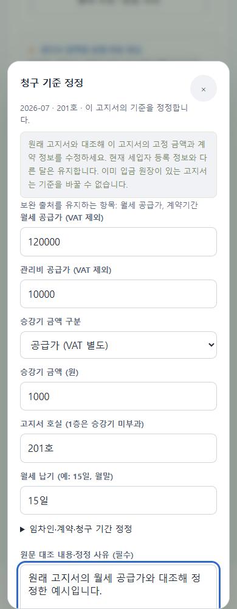
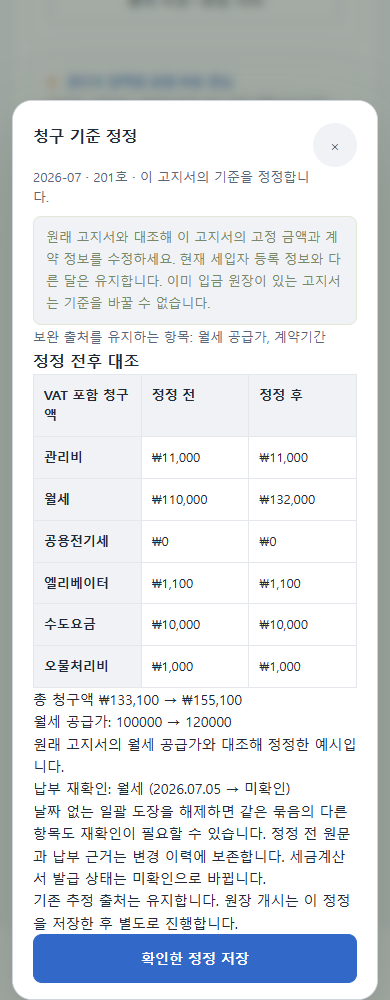

# 과거 고지서 청구 기준 정정 — 웹 2.1.3 개발

입금 원장을 시작하기 전에 잘못된 과거 고정 금액·호실·계약 정보를 해당 고지서에서 정정한다. 현재 임차인 등록 정보, 다른 달의 고지서, 이미 시작된 입금 원장 기준은 바꾸지 않는다. 운영 전체 자료의 대조 완료나 실제 Google 저장을 의미하지 않는다.

## 사용 흐름

1. 저장 고지서를 선택하고 **청구 기준 정정**을 연다. 원장 개시가 저장 원문 불일치로 중단된 경우에도 안내 화면에서 정정으로 이동할 수 있다. 화면을 여는 동작으로 저장하지 않는다.
2. 월세·관리비 공급가, 승강기 공급가 또는 VAT 포함 청구액, 과거 호실·월세 납기를 수정한다. 접힌 **임차인·계약·청구 기간 정정**에서 성명·상호·계약기간·최초 계약일·재계약·납부 방식과 항목별 기간을 수정한다. 자유 형식의 기존 계약 문자열은 유지할 수 있다.
3. 원문 대조 내용과 정정 사유를 입력하고 **정정 전후 확인**을 누른다. VAT 포함 6개 항목, 총 청구액, 수정한 문자 값, 납부 확인에 생기는 영향을 대조한다. 검토만으로 저장하지 않는다.
4. **확인한 정정 저장**으로 이 기기에 저장한다. 입력 수정은 준비한 후보를 취소하고 다시 대조하게 한다. 정정 전 저장 원문, 화면에 보완됐던 기준, 정정 후 값과 납부 근거를 기존 `audit.changes`에 기록한다. 고지서 변경 이력의 **정정 전 원문과 저장 결과**에서 확인할 수 있고 JSON 백업에도 포함된다. 기존 audit의 최근 100개 보관 규칙을 유지하므로 장기 보관할 원본은 별도 전체 백업으로 남긴다.
5. 입금 원장 개시·추가 입금은 정정 저장 후 별도 화면에서 진행한다. 같은 저장에서 청구 기준을 바꾸고 원장까지 여는 것은 계속 차단한다.

## 금액과 납부 근거

계산과 정정은 `RentalBilling.correctBillBasis` 및 기존 `invalidateChangedPayments`를 사용한다. 원 단위 정수와 0~1조 원 범위를 확인하고, 승강기 공급가와 실비 청구액을 구분한다. 1층 호실은 기존 규칙에 따라 승강기 청구액이 0원이다. 미부과 플래그·개별 납부의 NA·메모·nullable 값과 확장 정보는 유지한다. 수정하지 않은 숫자 문자열도 숫자로 다시 저장하지 않는다.

금액·미부과 상태가 달라진 항목의 기존 납부 날짜는 재확인 대상으로 처리한다. 날짜가 있는 일괄 도장을 해제하면 다른 항목의 기존 확인 날짜는 보존한다. **미래 확인 날짜도 보존하며 오늘 기준 수납액에는 포함하지 않는다.** 날짜가 없는 일괄 도장은 근거를 개별 날짜로 만들어낼 수 없어 같은 묶음도 재확인 대상이 된다. 검토 화면에서 영향을 받은 항목을 보여주고 정정 전 도장과 모든 원문 근거는 이력에 남긴다. 실제 입금일을 임의로 정정일로 바꾸지 않는다.

정정 저장 시 세금계산서 발급 상태는 미확인으로 바뀐다. 이미 발급한 외부 세금계산서를 변경하는 기능은 아니다. 공과금·승강기 청구액이 바뀌면 해당 월 정산의 `confirmed`를 해제하고 `needsReview`를 남긴다. 기존 정산 입력 자체는 보존한다. 고정 관리비 세부 항목은 자동 재배분하지 않으며 합계가 달라지면 기존 불일치 안내가 유지된다.

기존 `snapshotEstimated`는 수정한 항목까지 보존한다. 사용자 확인으로 과거 출처를 지우지 않으며 이후 원장 개시에서도 추정 기준 대조가 필요하다. 저장 원문에 없었던 기준을 명시적으로 저장하는 경우에도 사유와 정정 전 원문을 남긴다. 연도가 없는 확인 날짜는 고지서 월의 연도 또는 기존 동작대로 현재 연도를 사용한다. 미래 근거 조회용 기준일의 2200년으로 날짜를 바꾸지 않는다.

## 저장 보호

수정 후보는 별도 복사본으로 만들고 확정 전 전역 자료에 적용하지 않는다. 저장은 기존 Web Locks·원문 토큰·조건부 단일 쓰기·원장 이력 보호를 사용한다. 다른 창이나 이 화면이 열린 동안 현재 자료가 바뀌면 검토·저장을 중단한다. 실패하면 원문과 화면 입력·준비한 후보를 유지하고 재시도할 수 있다. 재시도는 이력을 중복 추가하지 않는다.

선택하지 않은 과거 고지서의 누락 snapshot을 함께 확정하지 않도록 저장 원문의 전체 자료를 기준으로 대상 고지서와 필요한 정산 확인 상태만 바꾼다. 현재 임차인과 다른 달의 오래된 원문 보존을 별도 브라우저 검사로 확인한다. 기존 검증기가 다른 고지서의 관리비 세부 항목 등을 자동 보정해야 하는 자료라면 이 정정 저장을 중단하고 원문 대조를 안내한다. 정정 대상 외 고지서의 보정을 함께 확정하지 않는다. 보관·미등록 고지서도 정정할 수 있고 현재 임차인 등록을 새로 만들지 않는다.

열려 있는 정정 화면에서는 자동 Google 동기화를 대기한다. 성공 후 기존 조건부 동기화가 이어지며 DB 저장과 Docs 생성 결과를 구분하는 계약을 유지한다. 실제 운영 연결·저장은 이번 검증 범위에 포함하지 않는다.

## 검증과 남은 범위

새 단위 검사 11개는 원문·확장 정보·추정 출처, 관련 납부 재확인, 미래 확인 보존, 날짜 없는 그룹, 승강기 실비/공급가와 1층, 납기·계약, 불완전 과거 자료, 잘못된 입력·기존 원장 거절, JSON 형식과 동시 개시 거절, 브라우저 API 없는 서버 실행을 검사한다.

새 Edge 시나리오 11개는 PC/모바일 대조·취소·대상만 저장, 금액/사유 검사와 후보 재검토, 승강기·정산·미부과, 미래/날짜 없는 그룹, 불완전 원문 정정 후 별도 원장 개시, 저장 실패 후 한 번만 저장, 다른 창 충돌, 실제 잠금 대기 후 재검사·저장 중 창 보존, 다른 달의 불완전 원문 보존·우발적 원문 보정 차단, 보관/미등록 자료·HTML 실행 방지·6개 화면 크기×100%/200% 글꼴·키보드 복귀를 검사한다. 익명 자료와 별도 프로필을 사용하고 외부 요청을 차단한다.

최종 전체 검사 수와 수행 시각, 소스·익명 화면 해시는 [개발 검증 요약](../releases/development-bill-basis-2.1.3.json)에 기록한다. 이전 개발 증거와 2.0.6 후보 ZIP은 보존한다. 실제 Google 전체 자료 대조, 이미 시작된 원장의 기준 변경 이관 정책, 새 후보 패키징, 승인된 운영 종단 저장, 휴대전화·실제 인쇄·스크린리더 검증은 남아 있다.

검증 소스는 `e08f915`다. 최종 `npm run test:all`에서 단위 검사 158/158와 브라우저 묶음 11/11, audit 69/69, 기존 입금 11/11, 원장 개시 대조 8/8, 새 정정 11/11, 분기 8/8을 확인했다. 빌드·문법·생성 파일 일치도 통과했다. 브라우저 수행 시각은 2026-10-09T22:46:10.007Z–22:51:14.814Z이며 실제 운영 저장의 검증 결과로 해석하지 않는다.
