# 독립앱 지속 보완 기록

전체 목표: 현재 독립앱을 기반으로 수정·보완·발전을 계속한다. 한 번의 개선 완료를 전체 목표 종료로 취급하지 않는다. 운영 배포와 실제 Google 데이터 변경은 별도 승인 대상이다.

현재 상태: 사용자의 후속 마무리 요청으로 작업을 재개했다. 기존 2.1.5 후보는 보존하고 로컬 2.2.0에 계약·수리 이력과 수입 추세, 읽기 전용 원자료 대조 목록을 구현했고 별도 비공개 저장소의 CI 전체 검사도 통과했다. 새 Google 검증용 Sheet·Doc·GAS bootstrap을 준비했으며 최초 권한 응답을 기다린다. 실제 운영 반영은 실행하지 않는다. 현재 항목별 완료·대기 상태는 [마무리 문서](FOLLOWUP_FINISH.md)로 확인한다.

## 2026-10-10 — 독립 Git와 자동 검사 마무리

별도 비공개 GitHub 저장소와 실제 Actions 실행을 연결했다. 과거 문서의 사업장명을 익명화한 사본을 검사하고 원본 로컬 이력은 보존했다. 첫 실행의 PWA 재진입 `load` 시간 초과를 검사 순서와 복원 화면 준비 조건으로 분리해 수정한 뒤, 원격 단위 192개·브라우저 14개 묶음·PWA 5개·PDF 5종 18페이지·생성물 일치 검사를 모두 통과했다. [실행 증거](../releases/ci-regression-2.2.0.json)와 [현재 완료·대기 범위](FOLLOWUP_FINISH.md)를 기록한다. Google 실제 제품 저장·운영 배포·실물 기기 검증은 대기 상태다.

## 2026-10-10 — 후속 운영 기능 2.2.0

계약 적용일·변경 이력, 월별 수입 추세, 수리와 증빙 기록을 추가했다. 이력의 원문을 지우거나 바꾸는 복원·서버 저장은 차단한다. 단위 192개와 브라우저 14개 묶음, PDF 5종·18페이지 및 운영 기능 화면 6개를 통과했다. 기존 테스트가 계약 이력을 지우는 빈 백업을 복원하려던 부분을 삭제 차단과 이력 보존 복원 검사로 나눠 수정했다. [개발 증거](../releases/development-2.2.0.json)와 [범위·제한](OPERATIONS_2.2.0.md)을 기록한다.

## 2026-10-10 — 이전 2.1.5 작업 마무리

남은 후보 manifest·압축본 검증 기록·README·로드맵·별도 Google 검증 계획을 로컬 Git에 함께 기록한다. 마무리 범위는 문서와 증거 정리이며 제품 소스 `4253948`과 검증 도구 `f426190`을 유지한다. 전체 제품 회귀와 압축본 실행 결과는 아래 수행 시각의 기존 검사 증거를 사용하고, 최종 생성물 일치·ZIP 재사용·해시·변경 문서·개인정보 포함 여부를 확인한다.

별도 사용자 요청으로 09:22:34–09:22:35(한국 시간)에 기존 독립 GAS의 `initializeIndependentApp`이 오류 없이 완료됐다. 기존 승인이 유효해 추가 승인 창이 없었다. 원격 시트·문서 ID, 프로젝트 속성의 독립 Calendar ID와 브라우저 저장 접두사를 읽기로 확인했고 운영 배포는 버전 4였다. 이는 기존 운영 1.0의 권한 확인이며, 2.1.5 실제 저장·문서 생성·일정 동기화 또는 배포 증거가 아니다.

## 2026-10-10 — GAS 2.1.5 후보와 압축본 PDF 검증

제품 소스 `4253948`을 유지하며 `f426190`에서 후보 검증에 인쇄 시나리오 5개와 결과 수집을 추가했다. [GAS 2.1.5 ZIP](GAS_REVIEW_CANDIDATE_2.1.5.md)은 **1,704,320 bytes**, SHA-256 `7feba52249ecde95ff9d657d8a6b54d6fe331ea01dff3c3528037aa65a3a0c49`이다. 파일 8개의 바이트·GAS 문법·권한/시간대·제품 검증 커밋을 대조한 뒤 ZIP readback 코드를 실행했다. 실제 임대 JSON·OAuth/서명 파일을 담지 않고 저장된 임차인 필드 값이 포함되지 않는 것도 확인했다.

**패키징 단위 8/8, 압축본 서버 모의 42/42, 화면 49/49**(입금 11·기준 대조 8·정정 11·분기 8·복원 6·인쇄 5) 통과. 수행 시각은 2026-10-10T00:14:05.729Z–00:15:41.852Z다. ZIP의 HTML로 생성한 PDF 5종·18페이지를 다시 읽어 검사하고 렌더링했으며, 앞서 검토한 제품 PDF의 18개 이미지와 모두 같은 해시였다. 기존 제품 전체 단위 178개·브라우저 묶음 13개를 이번 검사에 중복 합산하지 않는다. 동일 제품 파일 해시를 확인했으며 전체 제품 회귀는 반복하지 않았다.

두 번째 패키징은 같은 ZIP·manifest를 검증해 재사용했고 기존 2.1.4·2.1.3·2.0.6 ZIP과 기록을 보존했다. [생성 출처](../releases/gas-candidate-2.1.5.json), [압축본 검증 결과](../releases/validation-gas-candidate-2.1.5.json)를 보관한다. 실제 Google 호출·쓰기·업로드·배포·원격 push와 Android 변경은 수행하지 않았다. `productionReady:false`를 유지한다.

다음 실제 Google 확인을 위해 [별도 검증앱 계획](GOOGLE_STAGING_REVIEW.md)을 작성했다. 새 GAS·Sheet·Doc·Calendar를 만들고, 소스 사본의 대상 ID/주소/표시와 브라우저 저장 접두사를 바인딩하며 익명 자료의 실제 저장·원장·Docs/Calendar·출력을 확인하는 범위다. 기존 운영 ZIP의 ID를 그대로 쓰면 검증앱도 운영 대상에 연결되므로 분리가 필요하다. 계획은 아직 실행하지 않았다. 새 Google 자원 생성과 검증용 실제 쓰기는 프로젝트 AGENTS.md의 명시적 승인 범위를 따르며, 기존 운영 반영 승인을 포함하지 않는다. 후보 준비 후 사용자 요청에 따라 후속 개선을 일시 중단한다.

## 2026-10-10 — 웹 2.1.5: 고지서와 분기 PDF 실제 출력 보완

익명 자료를 Edge에서 PDF로 생성해 2.1.4의 조작 버튼·입금 날짜 겹침·포커스 이동 링크 출력·입금 메모의 페이지 분할·짧은 내역의 추가 빈 페이지를 확인했다. 출력용 CSS에서 고지서의 버튼과 기존 완납 조작/원장 시작 도움말, 포커스 링크를 숨기고 화면 최소 높이를 해제했다. 한 페이지에 들어갈 입금 기록은 같은 페이지에 유지한다. 기존 화면·원문·입금 이력과 core/billing/server Billing 해시는 유지했다. 고지서 HTML 변경은 조작/도움말의 클래스 두 종류뿐이며 서버 변경은 버전 문자열만이다.

같은 기존 고지서는 **2→1페이지**, 빈 분기 내역은 **2→1페이지**로 정리됐다. 익명 입금 원장 24건+사유 정정 1건은 PC/모바일 각각 5페이지로 전체 메모·원래 입금·정정 사유를 유지했다. 36명·108건의 분기 내역은 6페이지에서 모든 호실과 합계를 유지했다. A4 세로/가로, 빈 페이지와 페이지 밖 글자, 공유 규칙의 금액·잔액과 입금 메모가 한 페이지에 온전히 있는지를 실제 PDF 읽기로 검사했다. 5개 PDF의 **18페이지**를 Poppler로 렌더링해 모두 검토했고, 최종 전체 검사에서 생성한 이미지도 모두 일치했다.

검증 소스는 `4253948`이다. 최종 `npm run test:all`: **단위 178/178, 브라우저 묶음 13/13**(새 인쇄 5개 포함), PDF 읽기 **5/5** 통과. 전체 브라우저 수행은 2026-10-10T00:03:15.025Z–00:08:37.643Z다. 기존 빌드·문법·생성 파일 일치도 통과했다. 재실행 가능한 `npm run test:print`와 Python 읽기 검사, 익명 출력물 4종과 해시를 [인쇄 보완 안내](PRINT_OUTPUT.md)와 [개발 검증 기록](../releases/development-2.1.5.json)에 보관한다. 실제 자료 복원 검사는 이번 단계에서 반복하지 않았다.

이 검증은 Windows Edge의 로컬 PDF이며 실제 프린터·휴대전화 인쇄 창과 Google GAS iframe 동작을 입증하지 않는다. 이번 단계에서 Google API 호출·실제 쓰기·Docs/Calendar 실행·업로드·배포·원격 push·Android 변경은 수행하지 않았다. 최신 GAS 검토 ZIP은 기존 2.1.4이고 2.1.3·2.0.6 후보와 함께 같은 해시로 보존했다. 2.1.5 ZIP은 아직 만들지 않았다. 새 예시 미리보기는 http://127.0.0.1:4288/?demo=1 이며 이전 입력/캐시는 보존한다. 지속 개선 목표는 활성 상태다.

## 2026-10-10 — GAS 2.1.4 검토 ZIP과 복원·CSV 압축본 검사

검증된 웹 2.1.4 소스 `9ab701f`를 GAS 검토 ZIP으로 준비했다. `03a05e2`에서 후보 검사 도구에 익명 전체 복원 시나리오 6개를 추가하고, 부모 환경의 실제 입력 경로를 제거하며, 실패한 검사 결과를 기존 통과 결과로 수집하지 않도록 보완했다. 제품 소스·저장 형식·금액 규칙은 변경하지 않았다. 후보 생성과 도구 출처는 `03a05e2`, 제품 검증 출처는 `9ab701f`로 구분한다.

[새 검토 ZIP](GAS_REVIEW_CANDIDATE_2.1.4.md)은 **1,704,221 bytes**, SHA-256 `c151f751859517a307dfe0d44dcffeec7b618c0f77d8440d1610ccb997c87020`이다. 정확한 공개 파일 8개만 담고 ZIP readback을 검증된 제품 파일과 비교한 후 실행했다. **패키징 단위 8/8, 압축본 서버 모의 검사 42/42, 압축본 화면 44/44**(입금 11·개시 대조 8·정정 11·분기 8·복원 6) 통과. 브라우저 수행은 2026-10-09T23:50:25.482Z–23:51:55.092Z다. 존재하지 않는 비공개 입력 경로를 부모 환경에 지정했어도 복원 검사는 익명 자료를 사용해 통과하고 `privateInput:false`를 기록했다.

두 번째 패키징은 기존 ZIP과 manifest를 검증해 재사용했다. 기존 2.1.3·2.0.6 ZIP 해시와 기록을 보존했다. [후보 출처](../releases/gas-candidate-2.1.4.json)와 [압축본 검사 결과](../releases/validation-gas-candidate-2.1.4.json)를 보관한다. 이전 제품 전체 178개·브라우저 묶음 12개·실제 자료 복원 6개는 앞선 제품 검사이며 이번 압축본 검사에 중복 합산하지 않는다. 전체 제품 회귀는 반복하지 않았고 제품 파일 해시 일치를 확인했다.

Google API 호출·실제 쓰기·업로드·운영 배포·원격 push·Android 변경은 수행하지 않았다. Google iframe·소유자 로그인·실제 저장/Docs/Calendar와 실제 기기 검증은 이 로컬 VM/브라우저 검사로 입증하지 않는다. `productionReady:false`를 유지하며, 운영 상태의 마지막 별도 GET 확인은 제품 검증 기록의 시각을 따른다. 후속 운영 검토와 기기 확인, 과거 청구 원문·원장 개시 후 기준 변경 정책 확인은 계속 남아 있다. 지속 개선 목표는 활성 상태다.

## 2026-10-10 — 웹 2.1.4: 미발행 고지서 보존과 월별 CSV

실제 독립 운영 자료를 임시 로컬 브라우저에 복원해 기존 Git `e08f915`의 CSV를 내려받은 결과, 11개월 중 2개월에 미발행 임차인의 현재 월세·관리비가 포함돼 6행이 추가됐다. 저장 고지서 38건에 CSV 행 44개였다. `6417a33`에서 비어 있지 않은 저장 고지서만 내보내고, 재실행 초기화가 빈 객체에 청구 기준을 채우지 않도록 수정했다. `9ab701f`에서 월별 선택 표시를 **미작성**으로 맞췄다. 수정 후 11개월의 CSV 38행과 저장 고지서의 금액·합계가 모두 일치했다. 보관·미등록 임차인의 저장 고지서와 기존 16개 열·파일명·금액 규칙은 유지한다. [상세 경계와 재실행](MONTHLY_CSV_BOUNDARY.md)을 보관한다.

익명 기본 자료와 명시한 `.private` 실제 입력을 지원하는 복원 브라우저 검사 6개를 추가했다. 백업 미리보기 취소·적용·재실행·전체 JSON 왕복, 저장 고지서의 6개 금액과 추정 표시, 모든 월·분기의 CSV 다운로드/화면 집계, 미발행 입력 화면, 6개 크기와 7개 메뉴를 확인한다. 실제 자료의 스크린샷·금액·임차인 정보는 공유 기록에 남기지 않고 외부 요청을 차단한다. 실제 입력과 기존 앱 저장 키가 유지됨도 확인한다.

검증 소스는 `9ab701ff997ae9fba42b824d2c5d886a89f0621d`다. 최종 `npm run test:all`은 **단위 178/178, 브라우저 묶음 12/12**이며 익명 복원 6개가 이 묶음에 포함된다. 같은 소스의 실제 운영 자료 별도 복원 **6/6**도 통과했다. 전체 브라우저 수행은 2026-10-09T23:41:54.709Z–23:47:13.899Z, 한국 시간 10월 10일 08:41–08:47이다. 빌드·문법·생성 파일 일치도 통과했다. [검사 수·소스/화면 해시·전후 비교·운영 경계](../releases/development-2.1.4.json)를 기록한다. 일반 버전 검증 기록을 우선 읽도록 GAS 패키징 도구를 보완하고, 손상된 일반 기록을 과거 기록으로 우회하지 않는 단위 검사도 추가했다.

08:44의 독립 시트 재조회에서 3행 전체 원문이 동일했고, 08:45의 GET에서 운영 소스 8파일과 배포 버전 4가 동일했다. 운영 앱은 1.0을 유지한다. 기존 2.1.3 GAS 검토 ZIP과 Android 2.0.0 APK를 보존했고, 2.1.4 ZIP 생성·실제 저장·Docs/Calendar 실행·배포·원격 push는 하지 않았다. 새 예시 미리보기는 http://127.0.0.1:4287/?demo=1 이며 기존 포트의 입력/캐시는 보존한다. 실제 휴대전화와 프린터 검증, 과거 추정 기준 30건의 원문 대조, 원장 시작 후 청구 기준 변경 정책은 남아 있다. 지속 개선 목표는 활성 상태다.

## 2026-10-10 — 독립 운영 자료의 전체 계산 대조

`20f8e98`에 읽기 전용 `npm run reconcile:data`와 익명 단위 검사 12개를 추가했다. 기존 백업·GAS 저장 envelope·Sheets A열 JSON을 메모리에서 복제하며 입력·Google 서비스·브라우저 저장소에 쓰지 않는다. 결과는 Git 제외 `.private`의 새 파일로 제한하고 기존 결과를 보존한다. 납기·납부일 전날/당일/다음 날을 포함해 모든 저장 고지서의 6개 항목·납부일·미부과·수납/미납/체납 상태와 합계를 비교한다. JSON 검증의 필드 보정은 별도 보고한다. 기록된 원장을 지원하지 않는 구형 baseline은 거절한다.

직접 Sheets REST API는 비활성화 응답을 받았다. API 설정을 바꾸지 않고 Google Drive 플러그인의 metadata와 범위 읽기로 독립 시트 sheetId 0의 최신 3행 전체 JSON을 확보했다. 최초 읽기 시각은 2026-10-09T23:14:47.537Z, 최종 동일 원문 재조회는 23:21:37.316Z다. 운영 GAS Billing을 GET으로 읽어 복제 기준 `2b01a2e`와 생성 주석/줄바꿈 외 내용이 같음을 확인했다.

실제 자료는 임차인 4명·저장 월 11개·고지서 38건이다. 165개 날짜 기준 × 38건 × 6개 항목 = **37,620개** 대조에서 기존 계산과 새 계산, 새 공유 계산과 생성 GAS 계산 차이는 0건이다. 체납 총계·임차인 수납 상태 차이 0건, 분기별 저장 고지서 합계 **660개** 대조 차이 0건, core의 필드 보정/금액 변경 0건이다. 후보 GAS validator가 이 자료를 로컬 VM에서 수용하며 원문을 유지하는지도 확인했다. Google에서 실행한 쓰기 검사로 해석하지 않는다.

**과거 추정 표시가 있는 고지서 30건은 아직 원래 고지서·계약 자료 대조가 필요하다.** 필수 snapshot 누락과 운영 입금 원장 자료는 각각 0건이다. 계산 비교 `comparisonPassed`는 true지만 `reviewRequired`도 true이므로 명령 종료 코드 2다. 추정 표시를 제거하거나 원장/기준을 임의 생성하지 않는다. 비공개 결과의 `invoiceIndex`로 검토 번호를 원래 월·임차인 ID에 연결할 수 있으며 공유용 증거에서는 실제 ID·이름·연락처·금액을 제외한다.

새 대조 검사 **12/12**, 전체 단위 검사 **177/177**, 문법·생성 파일 일치 통과. 첫 검사에서 차이의 분류 필드가 변경 유형에 덮이는 문제를 발견해 구분하고 합계만/날짜만 달라지는 사례를 재검증했다. 제품 소스와 정상 ZIP은 변경하지 않았다. 이번에 전체 브라우저 묶음은 다시 실행하지 않았고, 이전 압축본 검사 기록은 별도로 유지한다. [대조 범위·재실행·검토 제한](OPERATING_DATA_RECONCILIATION.md)과 [개인정보 제외 증거](../releases/reconciliation-2.1.3.json)를 보관한다.

최종 GET 확인에서 운영 소스와 배포 버전 4를 유지했다. 실제 DB 쓰기·Docs 재생성·Calendar 동기화·배포·원격 push·Android 변경을 하지 않았다. 남은 과거 기준 원문 검토, 원장 기준 변경 이관 정책, 승인된 실제 저장/복구와 기기 검증을 계속 진행한다. 지속 개선 목표는 활성 상태다.

## 2026-10-10 — 웹 2.1.3 GAS 검토 후보와 압축본 검증

제품 코드·저장 형식·화면 버전은 앞선 `e08f915`를 유지한다. 공개 패키징/검증 도구를 `8345a8a`에 커밋하고 `npm run package:gas`, `npm run test:gas-candidate`를 추가했다. 기존 비공개 고정 버전 스크립트 대신 검증 기록·커밋·명시한 8개 공개 파일을 대조한다. 시각·순서를 고정한 ZIP을 만들고 다시 읽어 내용·크기·해시·GAS 문법·소유자 설정을 검사한 뒤 새 파일로만 저장한다. 기존 파일 또는 불완전 후보를 덮어쓰지 않는다. 같은 명령의 두 번째 실행은 기존 후보를 검증해 재사용했다.

새 로컬 [GAS 2.1.3 검토 후보](GAS_REVIEW_CANDIDATE_2.1.3.md)는 1,704,106 bytes, SHA-256 `46e4f65eab6cbf69344aae34d3ac245c1bc5c66cea3b7392b8ce8c87d0648e10`이다. 서버 7개 파일과 App.html만 포함하며 실제 임대 자료·OAuth 설정·서명키는 담지 않는다. 버전 2.0.6 이전 후보와 Android 2.0.0 APK도 보존했다. ZIP은 로컬 파일이며 Git에서 제외한다. manifest·검증 기록·생성 도구는 커밋한다.

마지막 검토에서 ZIP과 manifest가 함께 바뀌면 해시 일치만으로 검증 코드가 실행될 수 있는 점을 보완했다. `21afa67`에서 실행 전 각 압축 파일을 검증된 제품 소스와 대조하며, 함께 변조한 두 파일이 이 단계에서 거절되는 검사를 추가했다. 제품 코드와 정상 ZIP은 변경하지 않았다.

전체 단위 검사 **165/165**(새 패키징 검사 7개), 압축본 GAS 모의 검사 **42/42**, ZIP에서 읽은 App.html의 화면 검사 **38/38**(입금 11·원장 대조 8·정정 11·분기 8) 통과. 실행 전 제품 소스 대조 보완 후 압축본 수행 시각은 2026-10-09T23:09:30.733Z–23:10:47.139Z다. 다른 임시 경로에 생성한 ZIP의 바이트 일치, 덮어쓰기·추가 파일·경로 조작·손상·소스 변경·ZIP과 manifest 동시 변조 차단, GAS 문자열 전송의 nested null과 원장 프로토콜을 확인했다. 빌드 소스 일치·문법도 통과했다. [압축본 검사 증거](../releases/validation-gas-candidate-2.1.3.json)를 보관한다.

실제 ZIP의 GAS 코드와 HTML을 별도 임시 폴더/프로필에서 검사했다. 실제 Google 서비스는 모의 객체이며 외부 요청을 차단했다. PWA 정적 파일은 GAS ZIP에 포함하지 않으므로 앞선 제품 소스의 11개 전체 브라우저 묶음/PWA 검증을 압축본 검사로 재표시하지 않는다. 이번 도구 변경 후 전체 제품 브라우저 묶음은 다시 실행하지 않았으며 제품 파일 해시는 이전 검증과 동일하다.

원장 지원이 없는 옛 서버로의 단순 롤백 제한을 문서화했다. 새 원장 저장 후에는 모든 이력과 프로토콜을 보존하는 복구가 필요하다. 이미 시작된 원장의 청구 기준 변경 이관 정책, 실제 전체 자료 대조·승인된 운영 저장/Docs/Calendar·실제 기기 검증은 남아 있다. 검토 후보의 `productionReady`는 false다. GET 대조에서 독립 운영 소스·배포 버전 4 유지, 운영 앱 1.0 유지와 기존 2.0.6 ZIP 해시 보존을 확인했다. 배포·실제 쓰기·원격 push·Android 재빌드는 수행하지 않았다. 지속 개선 목표는 활성 상태다.

## 2026-10-10 — 웹 2.1.3 개발: 원장 전 과거 고지서 기준 정정

저장 고지서에 **청구 기준 정정**을 추가했다. 월세·관리비 공급가, 승강기 공급가/실비 청구액, 호실·납기, 과거 성명·상호·계약·청구 기간을 해당 고지서에서 수정하고 사유를 입력한다. 검토 화면에서 6개 항목의 VAT 포함 금액과 총액, 문자 값과 납부 확인 영향을 대조한 뒤 별도로 저장한다. 원장 개시와 같은 저장에 넣지 않으며 이미 원장이 있는 고지서의 기준 변경은 계속 거절한다. [사용 흐름과 제한](BILL_BASIS_CORRECTION.md)을 함께 확인한다.

확정 전 후보는 전역 자료와 분리하며 기존 원자적 저장·다른 창 충돌·잠금 안 재검사를 사용한다. 실패 시 입력과 기존 자료를 유지하고 재시도는 정정 이력을 한 건만 남긴다. 정정 전 저장 원문·화면의 보완 기준·정정 후 값·납부 근거를 기존 audit에 남기고 고지서에서 원문을 펼쳐 볼 수 있다. 변경하지 않은 숫자 문자열·nullable 값·확장 정보·추정 출처를 유지한다. 현재 세입자 등록을 수정하거나 미등록 임차인을 새로 만들지 않는다.

다른 달의 누락 snapshot까지 저장되는 문제를 피하도록 기기에 저장된 자료를 기준으로 대상 고지서와 필요한 정산 확인 상태만 반영한다. 다른 고지서의 세부 항목이 기존 검증에서 자동 보정되는 경우에는 이 저장을 중단하고 원문 대조를 안내한다. 1층 승강기 미부과·승강기 실비/공급가·기존 NA를 유지하고 공과금 청구가 바뀌면 정산의 확인 상태를 해제한다. 고정 관리비 세부 항목을 임의로 재배분하지 않는다.

공유 규칙 검사에서 기존 `d1da662`의 일괄 도장 해제 후 미래 `2199/07/05` 확인 날짜가 다른 항목에서도 없어지는 것을 재현했다. 날짜가 있는 그룹은 변경하지 않은 항목의 미래 날짜도 보존하고 오늘 수납은 0원으로 유지하도록 보완했다. 날짜 없는 일괄 도장은 기존 정책대로 묶음 재확인이 필요하며 검토 화면과 원문 이력에 그 영향을 보여준다. 세금계산서 발급 상태는 미확인으로 바뀌며 실제 외부 발급 문서를 변경하지 않는다.

모바일 검토에서는 입력칸을 접어 대조표와 저장 버튼을 볼 수 있게 했고 입력 수정은 같은 값과 사유를 유지하며 월세 입력으로 포커스를 돌린다. 추가 잠금 검사에서 저장 대기 중 Escape가 정정 창을 닫는 문제를 발견해 수정했다. 대기 중 창과 키보드 포커스를 유지하고 잠금 해제 후 원문·현재 자료를 다시 대조한다. 익명 PC·모바일 화면 6장을 보관했다.

검증 소스 커밋은 `e08f915`이다. 최종 전체 검사 수·수행 시각·소스 및 익명 화면 해시·운영 경계는 [2.1.3 개발 검증 요약](../releases/development-bill-basis-2.1.3.json)에 기록한다. 새 단위 검사 11개와 새 Edge 시나리오 11개를 추가했다. 기존 2.1.0/2.1.1/2.1.2 검증 기록은 유지한다.

최종 `npm run test:all` 통과: 단위 검사 **158/158**, 브라우저 묶음 **11/11**, audit **69/69**, 기존 입금 화면 **11/11**, 원장 개시 대조 **8/8**, 새 청구 기준 정정 **11/11**, 분기 화면 **8/8**. 브라우저 수행 시각은 2026-10-09T22:46:10.007Z–22:51:14.814Z다. 빌드·문법·생성 파일 일치도 통과했다. 월 snapshot이 없는 짧은 날짜는 기존 현재 연도를 유지하도록 마지막 보완·전용 검사 후 이 전체 검사를 실행했다. 정정 화면 캡처는 진입 애니메이션 종료 후 저장소를 바꾸지 않고 수행했다.

현재 예시 미리보기는 http://127.0.0.1:4286/?demo=1이다. 이전 포트의 입력·자료·캐시는 보존했다. GET 대조에서 독립 GAS 소스·배포 버전 4를 확인했으며 운영 앱은 1.0을 유지한다. 2.0.6 후보 ZIP도 보존했다. 이번 정정의 실제 Google 저장·Docs 재생성·Calendar 동기화·운영 배포·원격 push·Android 재빌드·휴대전화·실제 인쇄·스크린리더 검증은 수행하지 않았다.

다음 보완은 이미 시작된 원장의 청구 기준 변경에 필요한 이관 정책과 새 후보 패키징·실제 자료 대조다. 승인된 운영 종단 저장과 실제 기기 검증은 별도로 남아 있다. 지속 개선 목표는 활성 상태다.

## 2026-10-10 — 웹 2.1.2 개발: 원장 시작 전 청구 기준 대조

원장 시작 화면에 저장된 과거 임차 정보와 월세·관리비·전기·승강기·수도·오물의 청구액·확인액·잔액을 추가했다. 부가세 포함 금액·미부과·날짜 미지정·기존 확인 날짜를 공유 원장 조회로 표시한다. 보완된 항목은 월세 공급가·월세 납기·성명 등 읽을 수 있는 이름으로 표시하고 보관된 필드 목록은 바꾸지 않는다. 익명 예시 PC/모바일 화면을 검사했다.

기존 2.1.1의 실제 로컬 브라우저에서 미래 `2199/07/05` 월세 확인이 현재 공유 계산에서는 0원인데 시작 문구에는 110,000원으로 표시되는 오류를 재현했다. 상단과 항목 내역 모두 현재 수납 기준일의 0원을 사용하도록 수정하고 미래 확인 날짜는 별도로 표시한다. 기존 확인을 개시 날짜의 새 입금으로 만들거나 원문 날짜를 삭제하지 않는다.

입력 전 읽기 후보에 기존 저장 대조 검증을 적용한다. 화면에서 보완된 기준과 저장 원문이 다르면 **청구 기준 대조 필요**를 표시하고 입력·확인·저장을 중단한다. 고지서 대조 화면으로 이동해 원래 고지서와 비교하고, 기존 저장 버튼으로 기준을 별도로 저장한 후 원장을 시작할 수 있다. 이동만으로 저장하지 않으며 다른 창에서 변경된 경우 이동을 중단한다. 이미 시작한 원장의 청구 기준 고정과 사유 정정, 원문·기록 prefix 보호를 유지한다.

모바일에서 긴 항목 목록 때문에 입력까지 스크롤이 길어지는 점을 발견해 **입금 입력으로 이동**을 추가했다. 목록을 접고 입금액에 포커스를 옮기며 입력·대조 체크·준비한 기록을 바꾸지 않는다. 검토 단계에서는 입력 수정 버튼으로 이동한다. 중단된 경우에는 사용할 수 없는 입력칸을 감추고 대조 안내를 보여준다. [대조 흐름과 제한](RECEIPT_BASIS_REVIEW.md)을 함께 확인한다.

새 브라우저 시나리오 8개는 PC/모바일 항목 합계와 과거 임차 정보, 한국어 보완 목록·사용자 문자열의 HTML 실행 방지·추정/nullable 원문 유지, 입력 전 중단과 원문 보존, 별도 수동 저장 후 원장 입금 한 건, 미래 확인의 현재 0원 집계, 기존 원장의 잔액과 취소 시 보존, 6개 화면 크기×100%/200% 글꼴·키보드·입력 이동, 다른 창 변경 후 대조 화면 이동 중단을 검증한다. 원장 형식·JSON 형식·금액 배분·데이터 저장 코드는 변경하지 않았다. 새 라이브러리를 추가하지 않았다.

최종 `npm run test:all` 통과: 단위 검사 **147/147**, 브라우저 묶음 **10/10**, audit **69/69**, 입금 화면 **11/11**, 새 청구 기준 대조 **8/8**, 분기 집계 **8/8**. 최종 브라우저 수행 시각은 2026-10-09T22:12:43.629Z–22:17:18.014Z이다. 빌드·문법·생성 파일 일치도 통과했다. 화면 이동과 저장 결과를 실제 로컬 Edge에서 검사했으며 모의 외부 결과를 실제 운영 저장으로 보고하지 않는다. 금액·저장 코드의 기존 파일 해시와 2.0.6 후보 ZIP 보존도 대조했다.

검증한 소스는 `1db025d`이다. [2.1.2 개발 검증 요약](../releases/development-receipt-basis-2.1.2.json)에 검사 묶음·대조 시나리오·소스와 화면 해시·재현 사례·운영 경계·남은 범위를 보관한다. 이전 2.1.0 입금 및 2.1.1 분기 기록은 유지한다.

현재 개발 예시 미리보기는 http://127.0.0.1:4285/?demo=1이다. 기존 포트·저장 자료·캐시는 보존했다. 독립 GAS 소스·배포를 GET으로 대조해 기존 8개 파일과 배포 버전 4가 유지됐고 이전 2.0.6 ZIP의 SHA-256도 그대로였다. 운영 저장·Docs 재생성·Calendar 동기화·배포·원격 push·Android 재빌드는 수행하지 않았다. 2.1.2 후보 ZIP은 만들지 않았다. 실제 휴대전화·스크린리더 및 운영 원문 전체 대조는 남아 있다.

현재 고지서 수정 화면의 고정 청구액은 조회용이다. 원래 과거 금액이 다른 경우 이를 수정·대조·이력 보존하는 흐름과 이미 시작한 원장의 청구 기준 변경 이관은 후속 작업이다. 이번 안내 개선을 전체 이관 완료로 판단하지 않는다. 다음 작업은 원장 개시 전 과거 고정 금액과 계약 정보의 명시적 대조·수정 흐름이다. 지속 개선 목표는 활성 상태다.

## 2026-10-10 — 웹 2.1.1 개발: 저장 고지서 분기 집계

분기 화면·CSV의 중복 계산을 `RentalBilling.quarterlyStatement`로 통일했다. 저장하지 않은 달의 현재 월세를 매출로 더하던 오류를 기존 로컬 브라우저에서 재현했다. 7월 고지서 한 건의 실제 합계 131,000원이 기존 CSV에서는 373,000원·발급 표시 1/3건이었다. 이제 저장된 고지서만 모아 131,000원·1/1건을 출력한다. 발급 표시는 외부 전자세금계산서 서비스의 실제 발급 확인이 아니라 앱의 체크 상태다.

보관한 세입자·등록 자료가 없는 고지서를 포함하고 저장된 과거 호실·성명·상호가 다른 경우 별도 행으로 표시한다. 현재 사업자번호·대표자·보증금은 과거 임차 정보가 현재 등록과 같은 경우에만 출처를 밝히고 사용한다. 과거 값이 없는 경우에는 확인 필요로 남긴다. 부가세는 고지서 항목별 반올림을 합산하고 수도·승강기·오물 비용을 모두 포함한다. 부분입금·사유 정정과 잔액·연체·납기 전·납기 미지정을 공유 수납 계산으로 연결한다. 연체가 0이어도 잔액이 있으면 전액 확인으로 표시하지 않는다.

합계 카드와 12개 열의 명세표를 추가했다. 모바일에서는 명세표만 가로로 움직이고 방향키로도 스크롤할 수 있다. 200% 글꼴은 표에도 적용한다. 인쇄 스타일은 전체 열을 표시하고 인쇄 후 일반 화면으로 복귀한다. CSV 앞 13개 열 위치는 유지하되 제목을 저장 고지서·현재 등록 기준으로 명확히 바꾸고 확인액·잔액·기준일·과거 임차인 등 9개 열을 추가했다. 이전 열 제목이나 전체 열 수에 의존하는 수작업 양식은 새 CSV와 대조해야 한다. JSON 형식과 기존 고지서·입금·초안·원문은 변경하지 않는다. [집계 기준과 제한](QUARTERLY_STATEMENT.md)에 상세 내용을 기록한다.

최종 `npm run test:all` 통과: 단위 검사 **147/147**(새 집계 검사 8개), 브라우저 묶음 **9/9**, audit **69/69**, 입금 화면 **11/11**, 새 분기 화면 **8/8**. 브라우저 수행 시각은 2026-10-09T21:47:30.452Z–21:51:47.592Z다. 최초 전체 검사에서는 PWA 검사가 이전 버전 `2.1.0` 캐시를 찾는 문제로 실패했다. 검사 버전을 package.json에서 읽도록 수정한 뒤 PWA 5개와 전체 묶음을 재검증했다. 15개 자산 설치·오프라인·업데이트 대기·다른 캐시 보존 검사를 유지했다. 빌드·문법·생성 파일 일치도 통과했다.

검증한 소스 커밋은 `c595d30`이다. [2.1.1 개발 검증 요약](../releases/development-quarter-2.1.1.json)에 검사별 결과·소스/화면 해시·운영 경계·남은 작업을 보관한다. 이전 2.1.0 입금 검증 기록은 유지했다.

익명 자료로 PC·모바일 화면을 다시 캡처했다. 6개 화면 크기, 100%/200% 글꼴, 키보드 가로 스크롤, CSV 금액 일치, 인쇄 CSS·전체 열 표시·상태 복귀와 조회 전후 저장소 보존을 검사했다. 실제 프린터·휴대전화·스크린리더의 검증 결과로 해석하지 않는다.

현재 예시 미리보기는 http://127.0.0.1:4284/?demo=1이다. 기존 포트의 입력·자료·캐시는 보존한다. GET 대조에서 독립 GAS 소스·배포 버전 4가 유지됐고 기존 2.0.6 ZIP의 해시도 보존됐다. 사용자 요청에 따른 Google 권한 재확인은 별도 읽기 함수의 정상 완료이며 이번 집계의 실제 운영 저장 증거가 아니다. 운영 배포·실제 데이터 저장·Docs 재생성·Calendar 동기화·원격 push·Android 재빌드는 수행하지 않았다. 이번 소스는 로컬 개발본이며 2.1.1 릴리스 후보 ZIP은 만들지 않았다.

다음 보완 범위는 과거 청구 기준 대조·입금 원장 개시 안내와 사용 흐름, 변경된 청구 기준의 이관 정책이다. 후보 패키징·승인된 독립 운영 종단 검증·실제 기기와 출력 검증은 남아 있다. 지속 개선 목표는 활성 상태다.

## 2026-10-10 — 웹 2.1.0 개발 3단계: 입금 화면과 잔액 연결

고지서에서 **금액별 입금 기록 시작 → 항목·입금액·실제 입금일·메모 → 내용 확인 → 이 기기에 저장** 흐름을 구현했다. 날짜 미지정 과거 납부 근거와 새 실제 입금을 따로 표시한다. 잘못된 기록은 사유가 있는 정정 기록을 추가하며 원래 입금·도장·날짜를 삭제하지 않는다. 추정한 과거 청구 기준은 원래 고지서와 대조했다는 확인을 요구한다. 청구 기준이 저장 원문과 다르면 먼저 고지서 기준을 대조·저장하도록 안내한다.

월세 110,000원에 30,000원을 기록하면 잔액은 80,000원, 추가 80,000원 뒤 월세 잔액은 0원이다. 다른 공과금이 남아 있으면 전체 완납으로 표시하지 않는다. 홈·건물 운영현황·고지서·최근 입금·카카오 문구·월별 CSV·세무 체납·GAS 현황 문서가 공유 수납 계산을 사용한다. 원장 방식에서는 수도와 오물비를 포함한 여섯 항목의 실제 잔액으로 추가 입금을 안내한다. 기존 납부 방식과 배분 규칙은 유지한다.

저장 실패 시 이전 저장 자료·입력·준비한 기록 ID를 유지하고 실패 후보를 내보낼 수 있다. 다른 창이 고지서를 바꾸면 저장을 중단한다. 입력창이 열려 있으면 배경 자료 대체와 Google 쓰기를 보류한다. 원장의 초기 청구 기준·미부과 상태는 고정되며 기존 고지서 수정·재정산으로 바꿀 수 없다. 빈 새 기기에 전체 원장 백업을 적용할 수 있지만 이미 저장된 기록을 제거·재정렬·변조하는 이전 백업 복원은 거부한다. 원장 protocol과 구형 Google 서버의 쓰기 차단은 유지한다. [입금 계약과 제한](RECEIPT_LEDGER.md)을 함께 확인한다.

검사에서 새 확인 체크박스와 기존 세금계산서 체크박스의 식별자 충돌을 발견해 분리했다. PC 화면에서 정정 버튼이 기록 영역의 폭을 밀어 금액·날짜를 세로로 쪼개던 문제를 수정하고 실제 표시 폭을 검사했다. 원장 개시와 첫 입금의 시각이 같아도 새 입금을 과거 근거에 넣지 않도록, 과거 근거 목록은 보존된 header만으로 계산한다. 원장 화면의 묶음 상태 문구는 **관리비·공과금**, 입금이 없으면 **입금 기록 없음**으로 정리했다. 익명 자료의 PC·모바일 캡처를 보관한다.

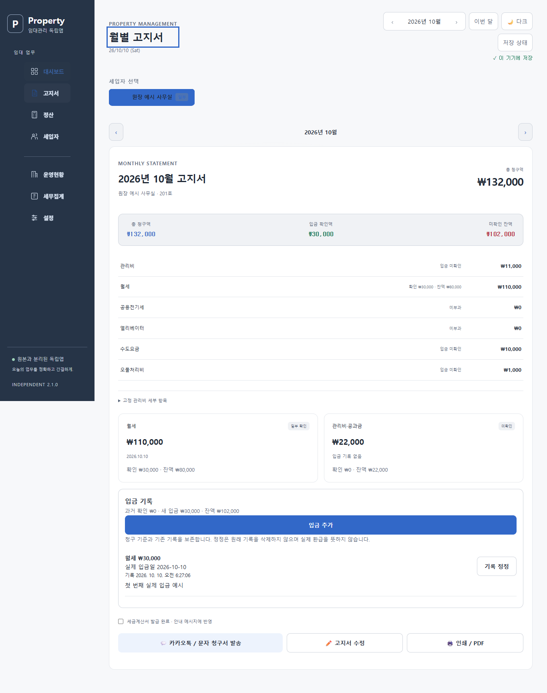
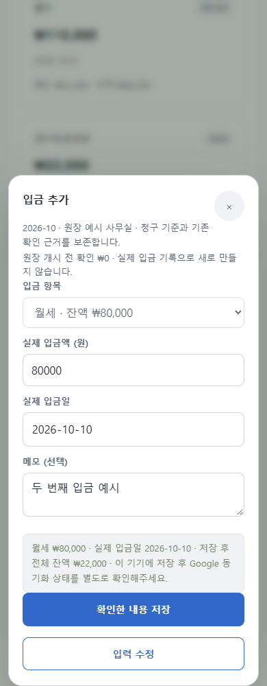

최종 `npm run test:all` 통과: 단위 검사 **139/139**, 브라우저 검사 묶음 **8/8**, audit **69/69**, 입금 화면 시나리오 **11/11**. 새 단위 검사는 공유 계산·GAS adapter 6개, 중복 화면 ID 1개, 현황 문서 1개다. 입금 화면 검사는 PC/모바일 두 입금·다시 실행·정정·추정 기준 확인·잘못된 금액/미래 날짜·quota·다른 창 충돌·전체 백업·구형 복원 차단·카카오/월별 CSV·운영/세무 체납·모의 응답 유실 재시도·6개 화면 크기/200% 글꼴/키보드를 포함한다. 새 화면과 기존 일괄 완납 회귀를 함께 검사했으며 기존 실패 검사를 제거하지 않았다. 빌드·문법·생성 파일 일치도 통과했다.

검증한 소스는 `7efc2dd`, 최종 브라우저 수행 시각은 2026-10-09T21:27:47.580Z–21:31:49.973Z이다. [개발 3단계 검증 요약](../releases/development-receipts-2.1.0-step3.json)에 각 묶음·11개 시나리오·소스 해시·남은 검증 범위를 기록한다. 현재 예시 미리보기는 http://127.0.0.1:4283/?demo=1이며 이전 포트의 입력·자료·캐시는 보존했다. GAS 소스와 배포를 GET으로 대조해 기존 소스·배포 버전 4가 유지된 것을 확인했다. 이전 2.0.6 ZIP의 SHA-256도 그대로다.

실제 Google 권한은 재확인했으나 이번 기능은 운영 배포 버전 4에 반영하지 않았다. 권한 확인 함수의 성공은 2.1.0의 실제 입금 저장 증거가 아니다. 운영 저장·Docs 생성·Calendar 동기화·원격 push·Android 재빌드·실제 휴대전화와 스크린리더 검증은 이 단계에서 수행하지 않는다. 기존 2.0.6 후보 ZIP과 개발 1·2단계 증거는 보존한다. 지속 개선 목표는 활성 상태다.

다음 로컬 보완은 과거 청구 기준 대조·원장 이관 안내, 분기 집계의 발행/예정 구분과 출력 금액을 점검하는 작업이다. 기준 금액을 바꾸면서 기존 입금을 조용히 재배분하거나 오래된 백업으로 이력을 제거하는 방식은 사용하지 않는다. 후보 패키징과 승인된 독립 운영 종단 검증은 별도 단계로 남긴다.

## 2026-10-10 — 웹 2.1.0 개발 2단계: 원장 저장 보호

공식 `bill.receiptLedger`를 클라이언트와 GAS에서 검증하고 실제 저장 전 자료와 대조한다. 기존 청구 기준·과거 확인·원장 header·기록 prefix를 보존하며 삭제·재정렬·변조와 오래된 백업 덮어쓰기를 거부한다. 새 입금·취소 추가, 저장 재시도, revision 충돌, chunk 원문과 nullable 자료 보존을 검사했다. 기존 저장 token·잠금·복구·저장 후 재조회는 유지한다.

현재 UI와 수납 계산의 연결은 남아 있다. 개발본은 원장 자료의 편집·가져오기·자동 대체를 중단하고 원문 내보내기를 안내한다. GAS는 명시적 원장 protocol을 요구하며 Docs 수납 연결 전에는 문서 생성을 중단하고 DB 저장 결과와 구분한다. 사용 가능한 부분입금 기능 전체 또는 2.1.0 릴리스 후보로 보고하지 않는다.

최종 `npm run test:all` 통과: 단위 검사 **131/131**, 브라우저 검사 묶음 **7/7**, audit **69/69**. 새 검사는 저장 7개·서버 6개·브라우저 4개다. PC/모바일의 200% 글꼴, 정확한 원문 내보내기, 가져오기 차단, 모의 Google 읽기/수동 업로드 차단을 포함한다. 검증 소스는 `731dbbb`, 최종 브라우저 종료 시각은 2026-10-09T20:58:57.076Z이다. [개발 2단계 검증 요약](../releases/development-receipts-2.1.0-step2.json)을 보관한다.

독립 GAS 소스와 배포를 GET으로 재조회해 배포 버전 4 유지, 2.0.6 후보 ZIP의 기존 SHA-256 보존을 확인했다. 실제 Google 데이터 저장·Docs 생성·Calendar 동기화·운영 배포·원격 push·Android 재빌드는 수행하지 않았다. 다음 필수 작업은 입금 입력·이력·정정 UI와 모든 수납 조회/출력·복원 이관 연결이다. 지속 개선 목표는 활성 상태다.

## 2026-10-10 — 웹 2.1.0 개발 기반 1단계

부분입금 원장의 계산·검증 기반을 구현했다. 기존 납부 도장/날짜를 과거 확인 근거로 보존하고 새 실제 입금·취소 참조·기준일/기록 확인 시각을 구분한다. 원 단위 잔액, 항목별 초과 방지, 동일 ID 재시도, 추정 snapshot 검토와 nullable 과거 자료를 검증한다. 구현 API와 정책·남은 화면/서버/백업 연결은 [부분입금 원장 개발 계약](RECEIPT_LEDGER.md)에 기록한다.

최종 `npm run test:all` 통과: 단위 검사 118개 중 118개(새 원장 검사 15개 포함), 브라우저 검사 묶음 7개 중 7개, 전체 audit 65개 중 65개. 빌드·문법·생성 파일 일치도 통과했다. 검증 소스 커밋은 `da275ab`이며 최종 수행 시각은 2026-10-09T20:43:03.915Z이다. 실제 로컬 Edge의 PC/모바일 두 context에서도 번들 API 호출, 30,000원+80,000원 집계와 취소, 기존 자료·저장소·기존 납부 계산 보존을 확인했다. 부분입금 화면을 사용한 검사가 아니다. [개발 기반 검증 요약](../releases/development-receipts-2.1.0-step1.json)에 결과와 미완료 연결 범위를 기록한다.

현재 화면과 기존 수납 함수는 아직 원장에 연결하지 않았다. 2.1.0 사용 가능한 릴리스 후보/입금 기능 전체 완료로 판단하지 않는다. 2.1.0 후보 ZIP을 만들지 않았으며 2.0.6 후보 ZIP의 해시 보존을 확인했다. 독립 GAS 소스와 배포를 GET으로 재조회해 기존 소스와 배포 버전 4가 유지된 것을 확인했다. 실제 Google 자료 저장·문서 재생성·일정 동기화·원격 push·운영 배포·Android 재빌드는 실행하지 않았다. 실제 휴대전화·스크린리더·운영 2.x 쓰기 검증은 남아 있다. 지속 개선 목표는 활성 상태다.

## 2026-10-10 — 웹 2.0.6

기준: 로컬 `f00127e`와 `candidate/independent-v205-f00127e`를 보존했다. 이전 후보 ZIP·해시·검증 결과를 유지한다.

### 실제 개선

- 설정의 백업 / 복원에 **백업 파일 확인**을 추가했다. 확인용 파일 선택은 기존 파일 가져오기와 분리된 입력을 사용한다. 창을 열거나 파일을 검사하는 동안 자료·초안·복원 지점·동기화 상태를 저장하지 않는다.
- 기존 `RentalCore.validateData`와 고지서/정산 초안 검증을 재사용한다. 백업 버전·기록된 백업 시각·임차인·고지서·대출·지출·정산·지원 형식 초안·복구 원문의 건수를 표시한다. 원문 확인이 필요한 초안, 정규화/기본값 추가, 복원 대상이 아닌 메타데이터를 안내한다. 검사한 파일을 자동 적용하지 않는다.
- 전체 임대 백업·초안 복구 원문 파일·손상 원본 보관 파일을 구분한다. 파일을 파싱할 수 있다는 사실만으로 전체 자료 복원에 사용할 수 있다고 표시하지 않는다. unsupported schema, 안전하지 않은 키, 잘못된 UTF-8/JSON과 10MB 초과는 명확히 안내한다.
- 이 창의 현재 임대 자료와 검증한 파일의 차이를 확인 시각과 함께 표시하고, **이 창 자료와 다시 비교**를 제공한다. 미저장 입력·초안·복구 원문은 임대 자료 비교에 포함하지 않는다고 표시한다. 현재 자료가 손상되었거나 다른 창 변경이 있으면 현재 자료 비교만 확인 필요로 표시하고 파일 형식 결과는 유지한다.
- 파일 지문은 선택한 원본 바이트의 SHA-256으로 계산한다. UTF-8 BOM도 지문에 포함한다. 지문은 같은 파일인지 구분하는 값이며 최신성이나 자료의 완전성을 보장하지 않는다. 지문 계산을 사용할 수 없는 환경에서도 별도로 끝난 형식 검사 결과를 유지한다.
- 읽기 오류, 파일 재선택, 창 닫기의 순서를 처리한다. 이전 읽기나 지문 계산이 늦게 끝나도 새 파일의 결과를 덮어쓰거나 닫힌 창을 다시 채우지 않는다. 닫으면 선택 자료와 결과를 현재 창에서 해제한다.
- PC/모바일에서 긴 파일명·지문을 줄바꿈하고 모바일 항목명·값을 나란히 표시했다. 기존 입력창의 배경 격리·Tab/Shift+Tab·Escape·설정 버튼으로 포커스 복귀를 사용한다.

임대 계산, JSON schemaVersion 1, 기존 가져오기/복원 적용 절차, 조건부 Google 저장과 원본/예시 모드 격리를 유지했다. 새 라이브러리를 추가하지 않았다.

### 검사

새 브라우저 시나리오 8개는 다음을 검증한다.

1. 실제 앱에서 내려받은 백업의 형식과 원본 바이트 지문 일치, 임대 자료·초안·저장소·동기화 상태 유지와 POST 없음.
2. 구형 백업, 기본값/값 정규화, 자료 차이·다시 비교와 비교할 수 없는 현재 저장 상태 안내.
3. 초안 원문·손상 원본·잘못된 JSON·unsupported schema·prototype 키·잘못된 루트 구조 구분, 파일명/원문의 HTML 실행 차단.
4. 자동 적용할 수 없는 초안·복구 원문·기기 메타데이터 안내, 기존 기기의 모든 기록과 원문 유지.
5. 늦게 끝난 파일 읽기, 재선택, 닫기, 읽기 오류와 다시 선택 후 정상 검사.
6. 잘못된 UTF-8, 10MB 초과, BOM 포함 바이트 지문, 지문 계산 실패 중 형식 결과 보존.
7. 6개 PC/모바일 화면 × 100%/200% 글꼴에서 가로 넘침 없음·44px 버튼·키보드 순환·Escape 복귀.
8. 오프라인과 예시 모드에서 검사, 원본과 독립 기기 저장소 유지, 외부 업로드 없음.

최종 `npm run test:all`은 통과했다. 단위 검사 103개 중 103개, 브라우저 검사 묶음 7개 중 7개, 전체 audit 65개 중 65개와 새 파일 확인 시나리오 8개 중 8개가 통과했다. 빌드·문법·생성 파일 일치 검사도 통과했다. 검증한 소스 커밋은 `f2cafe2`이다. 최종 브라우저 검사 시각은 한국 시간 2026. 10. 10. 오전 5:18:20–2026. 10. 10. 오전 5:22:03이다. [2.0.6 검증 요약](../releases/validation-2.0.6.json)에 결과를 기록한다. 후보 ZIP의 실제 8개 파일을 압축 안에서 읽어 manifest와 대조했고 현재 소스의 8개 파일 해시와도 일치한다. 이전 2.0.5 ZIP의 해시를 대조해 보존을 확인했다.

화면 캡처는 익명 예시 자료와 실제 로컬 서비스 워커의 제어권이 있는 별도 Edge 프로필을 사용했다. 파일 검사 전후 도메인과 저장소가 일치했다.

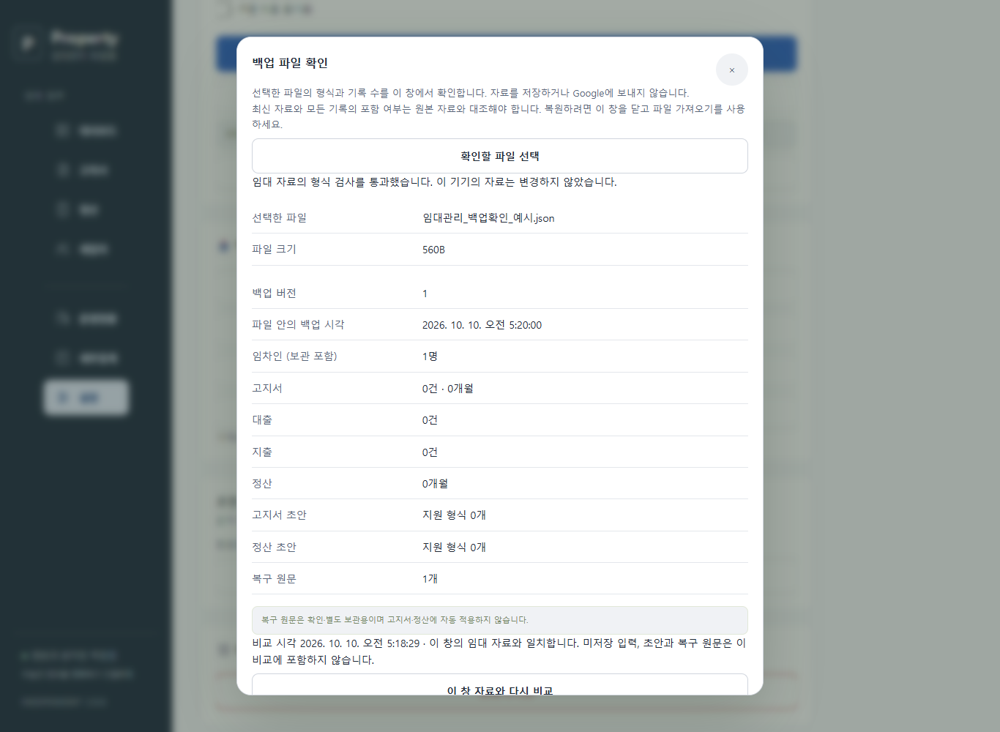
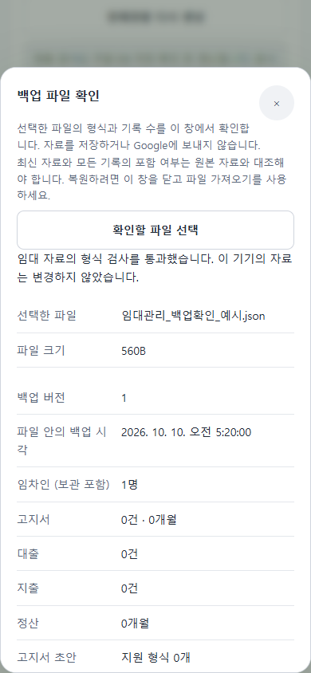
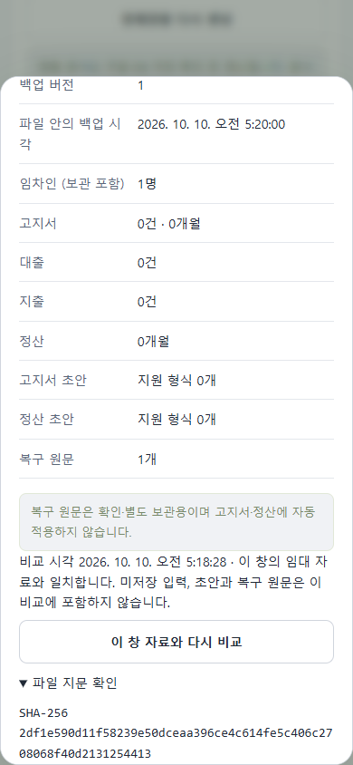

### 후보와 남은 범위

- 최신 예시 미리보기: http://127.0.0.1:4281/?demo=1. 이전 포트의 사용자 입력·캐시를 보존한다.
- [GAS 2.0.6 후보 ZIP](../releases/rental-independent-gas-2.0.6.zip), [8개 파일별 해시](../releases/gas-candidate-2.0.6.json), [검증 요약](../releases/validation-2.0.6.json).
- 독립 GAS 소스와 배포를 GET으로 재조회해 기존 소스와 배포 버전 4가 유지된 것을 확인했다. 이번 개선에서 실제 Google 자료 저장·문서 재생성·일정 동기화·원격 push·운영 배포를 실행하지 않았다. Android 후보는 기존 버전이다.
- 실제 휴대전화, 스크린리더, 운영 웹 2.x의 로그인·쓰기 검증은 남아 있다. 파일 형식 검사를 실제 운영 복원이나 모든 과거 자료의 금액 대조 결과로 확대하지 않는다.
- 전체 지속 개선 목표는 활성 상태다. 후속에서는 복구 원문의 공간 정리 절차와 부분입금 원장의 이관 설계를 검토한다.

## 2026-10-10 — 웹 2.0.5

기준: 로컬 `c50c076`와 `candidate/independent-v204-c50c076` 태그를 보존했다. 이전 후보 ZIP·manifest·검증 기록은 덮어쓰지 않는다.

### 실제 개선

- 설정과 기존 초안 안내에서 **초안 복구 원문** 창을 열 수 있다. 기록이 없어도 설정에서 상태를 확인할 수 있다.
- 고지서 초안·정산 초안·복구 기록 원문을 구분하고, 기기 보관·현재 창에만 있음·기존 초안 저장소에서 별도 보관 전의 상태를 표시한다. 보관 시각은 한국 시간, 원문 크기는 UTF-8 바이트로 표시한다. 남은 저장소 용량이라고 주장하지 않는다.
- 동일한 종류와 원문은 목록의 한 항목으로 모아 보관 여부를 보여 준다. 실제 저장 기록은 삭제/합치지 않으며 전체 내보내기의 기존 항목을 유지한다.
- **원문 보기**를 펼칠 때 읽기 전용 텍스트 영역을 생성한다. 원문을 HTML로 실행하지 않으며, 화면 미리보기를 고지서·정산에 적용하거나 서버에 전송하지 않는다. 개별 다운로드는 보관된 문자열의 CRLF·특수문자·한글을 그대로 포함한다.
- 개별 원문과 기존 전체 원문 내보내기를 제공한다. 원문 파일은 확인·별도 보관용이며 전체 임대 자료 복원용 백업과 구별한다. UI는 다운로드 시작을 알리고 파일 확인을 안내하며, 시작만으로 파일 보관이 완료됐다고 표시하지 않는다.
- 기기 미보관 원문에는 보관 재시도를 제공한다. 성공은 저장 후 문자열 재조회로 확인하며, 실패하면 현재 창의 원문·기존 초안·임대 자료를 유지한다. 원문을 자동 삭제하지 않는다.
- 다른 창의 복구 기록·초안 저장소 변경을 다시 읽어 목록을 갱신한다. 같은 개수의 기록 내용이 바뀌어도 갱신하며, 펼친 원문과 텍스트 선택·포커스를 유지한다.
- 기록 없음·읽기 오류·보관 실패를 구분한다. 초안 저장소를 읽지 못한 경우 전체 원문/전체 백업 내보내기를 성공으로 표시하지 않는다. 확인 가능한 개별 원문은 현재 창에서 내보낼 수 있다. 접근이 회복되면 새로 확인하여 읽기 오류 표시를 해제한다.

변경은 독립앱의 로컬 복구 UI와 기존 초안 읽기 실패 진단에 한정했다. 임대 계산·조건부 Google 저장·JSON schemaVersion 1·원본/예시 모드 namespace를 유지하며 새 라이브러리를 추가하지 않았다.

### 검사

새 브라우저 시나리오 8개는 다음을 검증한다.

1. 빈 목록을 설정에서 열기, 초기 포커스·Escape 복귀, 열기만으로 도메인과 저장소를 바꾸지 않음.
2. 기기 보관·현재 창·현재 초안·손상된 복구 wrapper를 함께 표시하며 원문을 자동 적용하지 않음.
3. 펼치기 전 텍스트 영역 없음, HTML 문자열의 실행 차단, 개별 파일의 원문/한글/CRLF/특수문자 일치.
4. quota 실패 후 원문 유지, 실패 해제 후 저장/재조회 확인, 호출 행으로 포커스 복귀와 재실행에서 보관 유지.
5. 두 창의 기록 추가와 같은 개수의 내용 교체를 반영하며 펼친 원문·텍스트 선택을 유지.
6. 복구/초안 저장소 읽기 오류를 알림, 현재 창의 개별 파일 내보내기, 읽기 실패 중 전체 내보내기 차단, 접근 회복 후 다시 확인.
7. 6개 PC/모바일 화면 × 100%/200% 글꼴에서 가로 넘침 없음, 44px 버튼, Tab/Shift+Tab 순환과 Escape 복귀.
8. 원본/예시 모드 기록 격리와 전체 백업의 원문 보존, 임대 도메인 유지.

최종 `npm run test:all`은 통과했다. 단위 검사 103개 중 103개, 브라우저 검사 묶음 7개 중 7개, 전체 audit 57개 중 57개와 새 복구 원문 시나리오 8개 중 8개가 통과했다. 빌드·문법·생성 파일 일치 검사도 통과했다. 검증한 소스 커밋은 `0300cbc`이며 최종 검사 시각은 한국 시간 2026-10-10 05:06:51–05:10:16이다. [2.0.5 검증 요약](../releases/validation-2.0.5.json)에 결과를 기록한다. 후보 ZIP의 실제 8개 파일을 압축 안에서 읽어 manifest와 대조했고, 현재 검증 소스의 8개 파일 해시와도 일치한다. 이전 2.0.4 ZIP 해시는 유지됐다.

최초 전체 검사에서는 기존 동시 초안 보관 검사가 한 번 실패했다. 두 탭의 보관 호출은 성공했지만 다른 탭의 기록을 즉시 읽을 때 1건만 보였다. 별도 Edge 프로필 12회 재현에서 즉시 읽기 1회는 1건이었고, 12회 모두 재실행과 새 탭에서 서로 다른 ID의 정확한 원문 2건을 확인했다. 이 범위에서는 데이터 유실이 관찰되지 않았다. 기존 검사는 두 탭에서 기록을 확인한 뒤 원문·고유 ID를 대조하고 새 탭에서도 다시 검증하도록 보강했다. [WHATWG WebStorage 명세](https://html.spec.whatwg.org/multipage/webstorage.html)는 다른 창의 storage 이벤트를 작업 큐에 넣도록 정의한다. 이 검사 결과를 모든 브라우저의 즉시 동기화 보장으로 확대하지 않는다.

아래 캡처는 익명 예시 자료와 실제 로컬 서비스 워커가 준비된 별도 Edge 프로필을 사용했다. quota 실패는 격리한 주입이며 실제 Google 장애가 아니다.

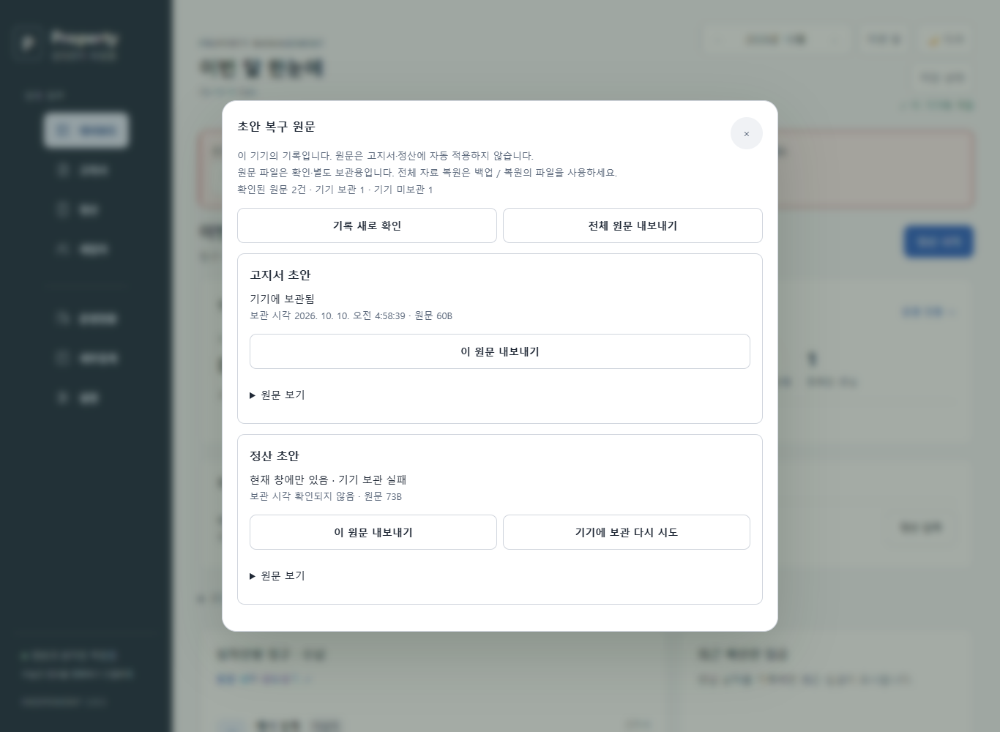
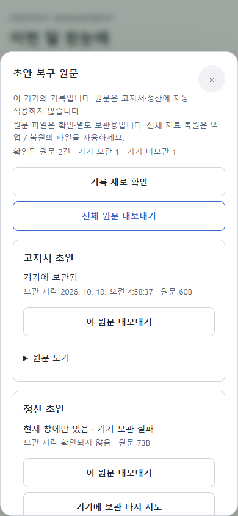
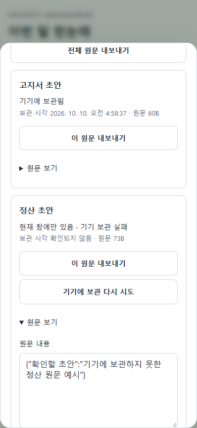

### 후보와 남은 범위

- 최신 미리보기: http://127.0.0.1:4280/?demo=1. 이전 포트의 사용자 입력과 설치 캐시는 보존한다.
- [GAS 2.0.5 후보 ZIP](../releases/rental-independent-gas-2.0.5.zip), [8개 파일별 해시](../releases/gas-candidate-2.0.5.json), [검증 요약](../releases/validation-2.0.5.json).
- 독립 GAS 소스·배포를 GET으로 재조회해 기존 소스와 배포 버전 4가 유지된 것을 확인했다. 실제 Google 자료 저장·문서 재생성·Calendar 일정 동기화·원격 push·운영 배포·Android 재빌드를 실행하지 않았다.
- 실제 휴대전화·스크린리더·운영 2.x 쓰기 검증은 남아 있다. 로컬 Edge 결과를 실제 기기 또는 운영 배포 결과로 바꾸어 보고하지 않는다.
- 원문 정리/삭제는 이번 버전에 추가하지 않았다. 다음에는 원문 보관 공간을 정리하는 복구 가능한 절차와 백업 파일 재확인 흐름을 검토한다. 전체 지속 개선 목표는 활성 상태다.

## 2026-10-10 — 웹 2.0.4

기준: 로컬 `aba6467`를 `candidate/independent-v203-aba6467` 태그로 보존했다. 앞선 후보 ZIP과 검증 기록도 보존한다.

### 실제 개선

- 모바일 더보기에서 메뉴를 선택하면 닫힌 메뉴의 버튼 대신 새 화면 제목으로 포커스를 옮긴다. PC·모바일의 7개 화면 이동에도 같은 기준을 사용한다. 최초 실행·최근 메뉴 복원에서는 사용자의 포커스를 강제로 옮기지 않는다.
- 키보드 첫 Tab에서 **업무 내용으로 바로 이동** 링크를 제공한다. 본문을 `main`으로 표시하고 링크 실행 시 본문으로 바로 이동한다.
- 세입자·대출·지출·월 선택·메시지·완납 날짜·자료 교체의 7개 입력/검토창은 최상위 창에만 포커스를 유지한다. 배경은 `inert`로 격리하고, Tab/Shift+Tab 순환과 Escape 닫기를 처리한다. 중첩 창을 닫으면 아래 창과 입력을 유지하며 기존 배경의 inert 상태도 복원한다.
- 저장 후 화면을 다시 그려도 세입자·대출·지출·완납 날짜 호출 버튼으로 돌아간다. 다시 그린 상세 영역이 접혔으면 해당 영역을 열어 호출 버튼을 사용할 수 있게 한다. 버튼이 없어졌으면 화면 제목을 사용한다.
- 입력창 내부의 링크·summary를 Tab 순서에 포함하고, 접힌 details의 입력칸·disabled·숨겨진 요소는 제외한다. Chromium이 접힌 details의 입력칸에도 사각형을 반환하는 경우를 별도로 처리한다.
- 저장 실패 안내를 입력창 안의 `role=status` 문구로도 제공한다. 긴 창에서는 안내를 상단에 고정하고 포커스 버튼을 화면 안에 유지한다. 실패 입력과 이전 저장 자료의 기존 보존 동작은 유지한다.
- 자료 교체 적용/잠금 대기에는 검토창을 유지하고 Escape 취소를 막는 기존 보호를 보존한다. 입력창의 Escape가 동시에 모바일 더보기까지 닫지 않도록 순서를 정리했다.

입력창의 배경 격리·키보드 순환·초기/복귀 포커스는 [W3C APG modal dialog 지침](https://www.w3.org/WAI/ARIA/apg/patterns/dialog-modal/)을 참고했다. 실제 스크린리더 음성 검사나 WCAG 전체 준수 판정으로 확대하지 않는다. 임대 계산·JSON schemaVersion 1·Google 쓰기 정책은 변경하지 않았다.

### 재현과 검사

기존 2.0.3의 모바일 더보기에서 설정을 선택하면 포커스가 사라지는 것을 `.private/v204-keyboard-repro.log`에 재현했다. 보완 중 캡처에서 긴 세입자 창의 오류 안내가 화면 밖에 있는 문제도 발견했고, 실제 화면 사각형과 가림 여부를 검사해 재현/수정했다. 단순 DOM 존재만으로 안내가 보인다고 판정하지 않는다.

새 키보드 시나리오 8개는 다음을 검증한다.

1. 모바일 더보기 선택 후 화면 안의 제목으로 포커스 이동.
2. PC/모바일 7개 화면과 본문 바로가기, 최초 실행/재실행에서 포커스를 빼앗지 않음, 도메인 유지.
3. 7개 입력/검토창의 초기 포커스·Tab/Shift+Tab·Escape·배경 격리.
4. 창 내부 링크·summary·접힌/펼친 details·disabled 입력의 실제 키보드 순서.
5. 세입자·대출·지출·입금 날짜 저장 후 다시 그린 호출 버튼으로 복귀.
6. 사라진 호출 버튼의 대체 제목, 중첩 창의 이전 입력과 기존 inert 상태 복원.
7. 저장 quota 실패 후 PC/모바일 × 100%/200% 글꼴에서 오류 안내와 포커스 버튼이 모두 화면 안에 있고 가려지지 않음, 입력 유지·Escape 복귀.
8. 자료 교체 잠금 대기의 Tab/Escape 보호와 모바일 더보기의 Escape 순서.

최종 `npm run test:all`은 통과했다. 단위 검사 103개 중 103개, 브라우저 검사 묶음 7개 중 7개, 새 키보드 시나리오 8개 중 8개가 통과했고 빌드·문법·생성 파일 일치 검사도 통과했다. 검증한 소스 커밋은 `86c8768`이다. 브라우저 전체 audit는 49개 모두 통과했다. 최종 수행 시각과 결과는 [2.0.4 검증 요약](../releases/validation-2.0.4.json)에 기록한다. 새 후보 ZIP의 실제 8개 파일을 압축 안에서 읽어 manifest 해시와 대조했고, 이전 2.0.3 ZIP의 해시도 유지된 것을 확인했다.

아래 캡처는 익명 예시 자료와 실제 로컬 서비스 워커가 준비된 별도 Edge 프로필을 사용했다. 저장 quota 실패는 테스트용 주입이며 실제 Google 장애가 아니다. 입력창 진입 애니메이션이 끝난 뒤 안내와 포커스 버튼의 화면 내 표시를 확인했다.

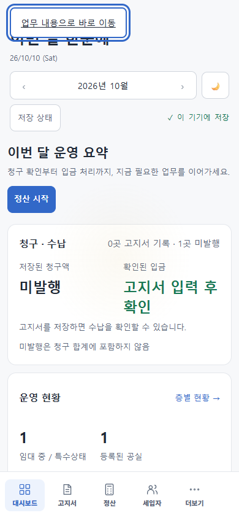
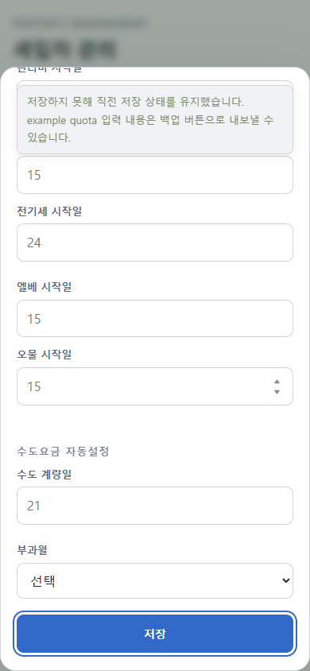
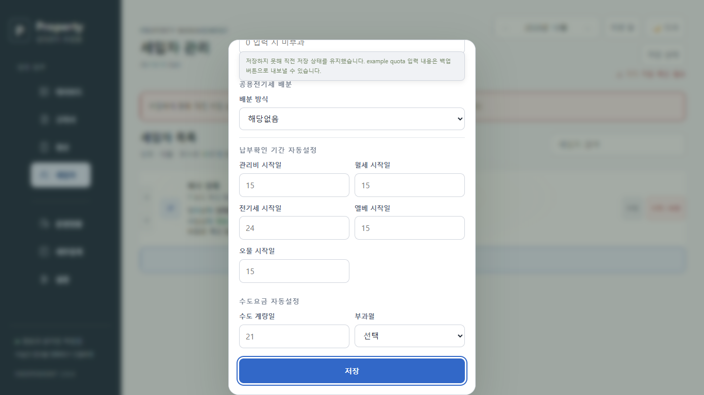

### 후보와 남은 범위

- 최신 미리보기: http://127.0.0.1:4279/?demo=1. 이전 포트의 사용자 입력과 설치 캐시는 보존한다.
- [GAS 2.0.4 후보 ZIP](../releases/rental-independent-gas-2.0.4.zip), [8개 파일별 해시](../releases/gas-candidate-2.0.4.json), [검증 요약](../releases/validation-2.0.4.json).
- 독립 GAS 소스·배포의 GET 재확인에서 기존 소스와 배포 버전 4가 유지됐다. Google 자료 저장·문서 재생성·Calendar 일정 동기화·원격 push·운영 배포·Android 재빌드를 실행하지 않았다.
- 사용자 요청에 따른 별도 권한 확인에서 기존 승인이 유효했으며, 복제 문서 접근 함수와 새 시트/문서/Calendar 접근 함수가 Google 편집기에서 오류 없이 실행 완료됐다. 이 결과를 2.0.4 운영 배포 증거로 취급하지 않는다.
- 실제 스크린리더·휴대전화 키보드/로그인·APK 설치와 운영 2.x 쓰기 검증은 남아 있다. 로컬 Edge 시나리오를 실제 기기 검증이라고 보고하지 않는다.
- 다음은 초안 원문 복구 기록의 보관 현황·내보내기·정리 흐름을 검토한다. 자동 원문 삭제는 하지 않는다. 전체 지속 개선 목표는 활성 상태다.

## 2026-10-10 — 웹 2.0.3 기록

기준: 로컬 `1cfc6fc`를 `candidate/independent-v202-1cfc6fc` 태그로 보존했다. 앞선 버전 후보와 검증 기록은 보존한다.

### 실제 개선

- 고지서·정산 초안의 JSON 파싱 실패와 적용할 수 없는 필드·형식을 발견하면 별도 **초안 확인 필요** 안내를 표시한다. 읽기만으로 원문을 고치거나 임대 도메인을 바꾸지 않는다. 유효한 기존 필드는 기존 고지서/정산 기준 비교를 통과할 때만 적용한다.
- 손상되거나 지원하지 않는 내용이 있는 초안 저장소를 갱신하기 전, 원문 문자열을 독립 저장소의 별도 복구 기록에 저장하고 재조회해 확인한다. 보관 실패 시 기존 초안 저장소를 덮어쓰지 않는다. 현재 입력과 원문은 창에 유지하며 파일로 내보낼 수 있다.
- 복구 기록은 각각 새로운 저장 키에 보관하여 다른 창의 기록을 덮어쓰지 않는다. 같은 원문을 반복 가져올 때 이미 보관한 기록은 재사용한다. 원본 앱과 예시 모드의 복구 기록도 기존 namespace로 분리한다.
- 전체 JSON 백업·직전 복원 지점·손상 원본 내보내기에 복구 원문을 포함한다. 파일 가져오기/복원은 확인이 필요한 초안의 처리 방법을 먼저 안내하고, 승인 후 원문 보관을 완료해야 임대 자료를 교체한다. 보관에 실패하면 이전 도메인과 복원 지점을 유지한다.
- 복구 원문은 기존 기기 메타데이터 `localMeta.draftRecovery` 안에 보관한다. `schemaVersion 1`과 정상 임대 데이터 형식을 유지하며, 서버로 전송하는 임대 도메인에 복구 원문을 넣지 않는다. 직전 2.0.2의 실제 validator를 읽어 새 백업의 도메인이 동일하고 메타데이터가 제외되는 것을 확인했다.
- raw 문자열은 화면 HTML에 넣지 않는다. 원문 내보내기 버튼은 44px 이상이며 PC/모바일·큰 글꼴에서 가로 넘침 없이 사용 가능하다. 기기에 보관하지 못한 복구 기록이 남아 있으면 창 닫기 전에 내보내도록 안내한다.

### 재현과 검사

기존 2.0.2는 손상된 고지서 초안 저장소를 빈 초안으로 읽은 후 다음 입력 저장으로 덮어쓰며, 백업에도 원문이 없었다. `.private/v203-draft-repro.log`에서 유실을 재현했다. 새 브라우저 시나리오 8개는 다음을 확인한다.

1. 손상 문자열이 다음 입력 저장 전에 보관되고 백업에 그대로 포함된다.
2. 정상/지원하지 않는 필드가 섞여도 읽기만으로 저장소를 바꾸지 않으며, 이후 변경과 재실행에서도 원문과 새 입력을 유지한다.
3. 고지서·정산 원문 보관 quota 실패 시 원문 저장소를 유지하고 새 입력을 내보낼 수 있다. 실패 해제 후 보관/저장 재시도도 확인한다.
4. 잘못된 가져오기 메타데이터는 취소 시 아무 것도 보관하지 않고, 승인 후 별도 원문으로 보관한다. 도메인과 HTML에 섞이지 않는다.
5. 가져올 원문 보관 실패 시 이전 도메인·상태 저장·복원 지점이 유지되고 가져올 원문도 내보낼 수 있다.
6. 전체 JSON 내보내기/가져오기 왕복, 직전 복원 및 반복 가져오기에서 원문이 유지된다.
7. 두 창의 원문 기록은 각각 남고 원본·예시 모드 기록은 분리된다.
8. 6개 화면 크기 × 100%/200% 글꼴에서 44px 버튼·가로 넘침 없음·원문 다운로드를 확인한다.

최종 `npm run test:all`은 통과했다. 단위 검사 103개 중 103개, 브라우저 검사 묶음 7개 중 7개, 새 초안 복구 시나리오 8개 중 8개가 통과했고 빌드·문법·생성 파일 일치 검사도 통과했다. 검증한 소스 커밋은 `4f857a7`다. 추가 단위 검사는 복구 메타데이터가 임대 도메인·서버 전송용 envelope에 포함되지 않으면서 미래 도메인 확장 필드는 유지되는 것을 확인한다. 최종 수행 시각과 전체 결과는 [2.0.3 검증 요약](../releases/validation-2.0.3.json)에 기록한다.

아래 화면은 익명 fixture를 사용했고, 실제 로컬 서비스 워커가 준비된 별도 브라우저에서 캡처했다. 실패 주입 검사와 별도로 서비스 워커 차단에 따른 오프라인 준비 오류가 없는 정상 실행 환경의 안내를 확인했다.

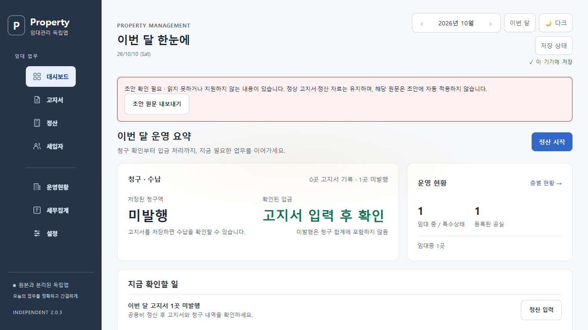
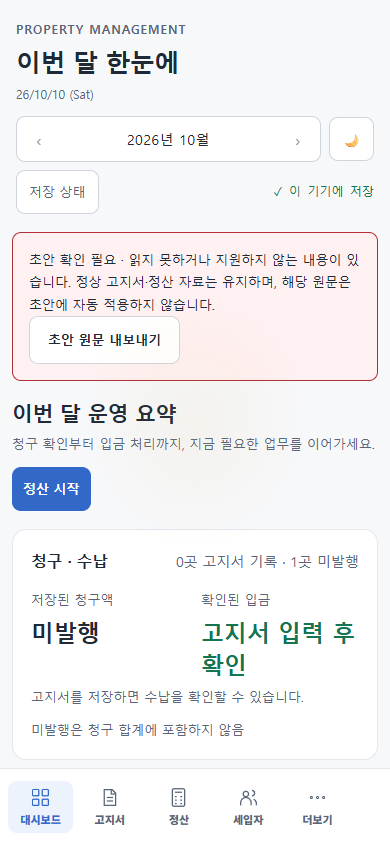

### 후보와 남은 범위

- 최신 미리보기: http://127.0.0.1:4278/?demo=1. 이전 포트의 사용자 입력과 설치 캐시를 지우지 않는다.
- [GAS 2.0.3 후보 ZIP](../releases/rental-independent-gas-2.0.3.zip), [파일별 해시](../releases/gas-candidate-2.0.3.json), [검증 요약](../releases/validation-2.0.3.json).
- 독립 GAS 소스·배포의 GET 재확인에서 기존 소스와 배포 버전 4가 유지됐다. 실제 Google 자료 쓰기·원격 push·운영 배포·Android 재빌드를 하지 않았다.
- 복구 기록을 자동으로 삭제하지 않는다. 내보낸 기록의 안전한 정리 흐름과 기기 저장 공간 안내는 후속 작업이다. 전체 고지서·정산 초안의 두 창 동시 편집을 병합하는 기능으로 확대 해석하지 않는다.
- 다음은 업무 화면의 키보드·포커스·문구 점검과 복구 기록 정리 흐름을 보완한다. 부분입금/계약 적용일 등 도메인 정책 변경과 실제 기기·운영 배포 증거는 별도 작업이다. 전체 지속 개선 목표는 활성 상태다.

## 2026-10-10 — 웹 2.0.2 기록

기준: 로컬 `64a6eba`를 `candidate/independent-v201-64a6eba` 태그로 보존했다. 2.0.1 후보 ZIP·manifest·검증 요약을 덮어쓰지 않는다.

### 실제 개선

- Google 자료 불러오기는 다운로드 후 **Google 자료 불러오기 검토** 창에서 현재 자료와 실제 변경 값을 비교한다. 적용 전에는 임대 도메인·복원 지점·동기화 기준을 바꾸지 않는다. 취소와 Escape는 현재 자료·고지서 초안·기존 미확인 저장 요청을 유지한다.
- 적용을 누르면 Google 자료를 다시 읽는다. 검토한 revision 또는 전체 도메인 내용이 달라졌거나 서버의 조건부 저장 지원 여부가 바뀌면 적용을 중단하고 다시 비교하도록 안내한다. 기존 서버도 두 번 조회한 내용이 같으면 읽기만 허용하고 업로드 차단을 명시한다.
- 다운로드·검토·재조회·기기 저장 잠금 대기 각각의 단계에서 현재 입력·도메인·다른 창의 저장이 바뀌었는지 검사한다. 잠금 안에서도 검사한 후 복원 지점을 남긴다. 확인 중에는 창을 유지하고 버튼을 잠근다.
- 기존 초안 처리 규칙을 보존한다. 적용 직전 현재 자료와 고지서·정산 초안을 백업하고, 고지서 초안은 비우며 정산 초안은 기기에 유지한다. 정산 초안은 기존 기준 자료 비교를 통과할 때만 자동 적용한다. 자료가 같아도 초안 처리와 동기화 기준 갱신이 일어나는 것을 화면에 설명한다.
- 불러오기는 GET만 사용한다. 다음 명시적 저장에서는 승인한 서버 revision을 `expectedRevision`으로 사용한다. DB 저장 이후 문서 갱신 실패는 DB 성공과 별도로 표시하는 기존 처리를 보존한다.
- 포커스 이동의 change 이벤트 때문에 기존 입력을 검토 중 새 편집으로 오인하던 문제를 수정했다. 다른 창의 저장으로 중단된 요청과 실제 시간 초과도 구분한다.
- 긴 동기화 상태는 큰 글꼴에서 줄바꿈한다. 모바일 비교표는 항목 이름 아래에 현재 값과 가져올 값을 나란히 표시하여 가로 이동 없이 비교할 수 있다. PC 표는 유지한다.

### 재현과 검사

기존 2.0.1에서는 Google 불러오기의 일반 확인창을 수락한 뒤 실제 비교 창이 나타나지 않는 실패를 재현했다. `.private/v202-cloud-review-repro.log`에 기록했다. 새 브라우저 시나리오 8개는 다음을 검증한다.

1. 적용 전 쓰기 없음, 취소 후 전체 임대 자료·초안·동기화 기준·미확인 요청 보존과 자동 POST 없음.
2. PC/모바일 재조회 후 적용, 확장 필드·null·빈 문자열·0 보존, 다시 열기, 초안 포함 복원, 다음 저장의 expectedRevision과 DB/Docs 별도 결과.
3. 검토 중 revision·내용·조건부 저장 기능 변경 시 적용 차단. legacy 서버의 내용 변경도 차단.
4. 검토·재조회 중 입력 수정 또는 다른 창 저장 시 자료 보존과 원인에 맞는 안내.
5. 기기 잠금 대기 중 편집, 상태 저장 quota 실패, 복원 지점 quota 실패 시 현재 자료 보존.
6. 첫 조회·재조회에서 잘못된 자료 또는 네트워크 실패 시 현재 자료 보존과 비교 창 정리.
7. 같은 자료를 불러올 때 초안 영향 안내, 정산 초안·복구 초안 보존, legacy 읽기와 업로드 차단.
8. 6개 화면 크기 × 100%/200% 글꼴에서 버튼 표시·44px 터치·가로 넘침 없음·모바일 표 가로 이동 없음과 Escape 취소.

최종 `npm run test:all`이 통과했다. 단위 검사 102개 중 102개, 브라우저 검사 묶음 7개 중 7개, 새 Google 검토 시나리오 8개 중 8개가 통과했고 빌드·문법·생성 파일 일치 검사도 통과했다. 검증한 소스 커밋은 `621b89a`다. 최종 전체 검사 결과와 수행 시각은 [2.0.2 검증 요약](../releases/validation-2.0.2.json)에 기록한다. 실제 Google 서비스 테스트로 오인하지 않도록 모든 불러오기·저장·문서 실패 시나리오는 격리한 예시 자료와 모의 응답을 사용했다.

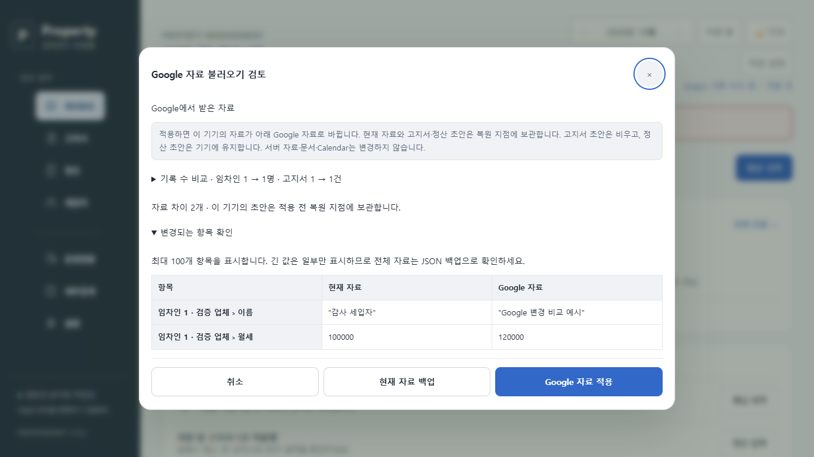
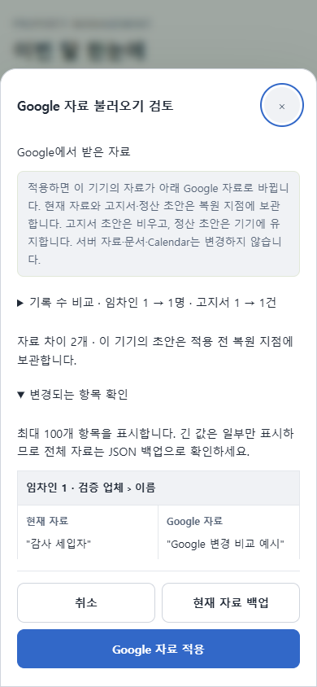

### 후보와 남은 범위

- 최신 미리보기: http://127.0.0.1:4277/?demo=1. 이전 포트의 사용자 입력과 설치 캐시를 지우지 않는다.
- [GAS 2.0.2 후보 ZIP](../releases/rental-independent-gas-2.0.2.zip), [파일별 해시](../releases/gas-candidate-2.0.2.json), [검증 요약](../releases/validation-2.0.2.json).
- 독립 GAS 소스·배포를 GET으로 재확인했고 기존 소스와 배포 버전 4가 유지됐다. 이번에는 실제 데이터 쓰기·원격 push·운영 배포를 하지 않았다. Android native는 기존 서명 2.0.0을 유지하며 휴대전화 소유자 로그인은 아직 검증하지 않았다.
- 재조회 완료 이후 다른 기기가 서버를 수정할 수 있다. 클라이언트의 검토 동안 서버 잠금을 유지한다고 주장하지 않는다. 이후 업로드의 expectedRevision 충돌 검사가 다른 변경을 덮어쓰지 못하게 한다.
- 다음 보완은 손상된 초안 메타데이터의 원문 보존과 진단, 일곱 업무 화면의 키보드·포커스·문구 점검 순서다. 전체 지속 개선 목표는 활성 상태다.

## 2026-10-10 — 웹 2.0.1 기록

기준: 로컬 HEAD 74df177, clean worktree. 기존 2.0.0을 candidate/independent-v2-74df177 태그로 보존하고 같은 독립 개발 브랜치에서 진행했다. 기존 계산·임대 schemaVersion 1·원본 분리·JSON 백업·Cloud revision/requestId 계약을 유지했다.

### 실제 개선

- JSON 파일 가져오기와 직전 복원 지점의 적용 전에 **복원할 자료 미리보기**를 표시한다. 적용 전에는 임대 도메인과 복원 지점을 쓰지 않는다. 편집한 고지서/정산 초안은 기존 방식으로 기기에 보관한다.
- 임차인·고지서·대출·지출 기록 수를 비교하고, 계약·금액·입금 등의 필드 차이를 실제 자료로 보여준다. 주요 필드는 업무 용어로 표시하고 null·빈 문자열·0을 구분한다. 최대 100개 차이와 각 값 500자까지 표시한다. 원문 전체는 파일 백업으로 확인할 수 있다.
- 취소·Escape·바깥 영역 클릭은 현재 임대 자료를 유지한다. 적용 직전 현재 자료를 복원 지점으로 보관하고 Google 저장은 따로 진행한다.
- 미리보기 중 로컬 입력, 도메인, 다른 창의 저장이 바뀌면 이전 비교 결과를 적용하지 않는다. 백그라운드 조회/자동 저장은 미리보기 중 보류하며 미리보기 이전에 시작된 응답도 적용하지 않는다.
- 적용 후 잠금 대기와 저장 검증이 끝날 때까지 창을 유지하고 조작을 잠근다. quota 실패 시 기존 자료를 유지한다.
- 큰 글꼴과 작은 화면에서도 취소·백업·적용 버튼이 항상 표시되도록 본문만 스크롤한다. 기록 수는 펼쳐보기, 변경 내용은 우선 표시한다.
- 정산 초안의 미리보기 건수는 기존 저장 검증을 통과한 메타데이터로 계산한다. 잘못된 문자열 메타데이터가 과장된 초안 개수나 대량 Object.keys 호출로 이어지지 않는다.
- 빌드가 package.json과 화면·클라이언트·GAS 응답·PWA 캐시·메뉴 표시의 웹 버전 일치를 검사한다. 최신 웹 버전은 2.0.1이다. Android 바이너리는 기존 서명 2.0.0을 사용한다.

### 재현과 검사

기존 구현은 확인 팝업 수락 직후 자료가 바뀌어 검토/취소 UI가 없었다. 변경 전 실패를 .private/backup-review-repro.log에 기록했다. 이후 실제 브라우저 검사 7개를 추가했다.

1. 검토 전 쓰기 없음과 취소 시 현재 도메인 유지.
2. PC/모바일 승인 후 전체 자료 적용, 직전 복구, 재실행, null·빈 문자열·0·미래 확장 보존 및 HTML 삽입 방어.
3. 미리보기 중 입력·도메인·다른 창 변경 시 적용 차단.
4. Escape 취소 및 미리보기 중 Google 요청 보류.
5. 잠금 대기 중 창 유지, 버튼 잠금, quota 실패 후 현재 자료 보존.
6. 6개 뷰포트 × 100%/200% 글꼴에서 버튼 표시·44px 터치·가로 넘침 검사.
7. 잘못된 초안 메타데이터를 포함한 기존 JSON의 도메인 복원 호환성.

기존 회귀 검사도 복원 미리보기를 실제 클릭하도록 변경했다. 검사를 삭제하거나 단순히 건너뛰지 않는다. 최종 전체 검사 `npm run test:all`은 통과했다. 단위 검사 102개 중 102개, 브라우저 검사 묶음 7개 중 7개, 추가 복원 시나리오 7개 중 7개가 통과했고 빌드·생성 파일 일치·문법 검사도 통과했다. 검증한 소스 커밋은 `d1b071d`다. 최종 수행 시각과 결과는 [2.0.1 검증 요약](../releases/validation-2.0.1.json)을 기준으로 한다. 실제 Google 저장·Docs/Calendar 갱신과 운영 배포는 이번 보완의 검증에 포함하지 않는다.

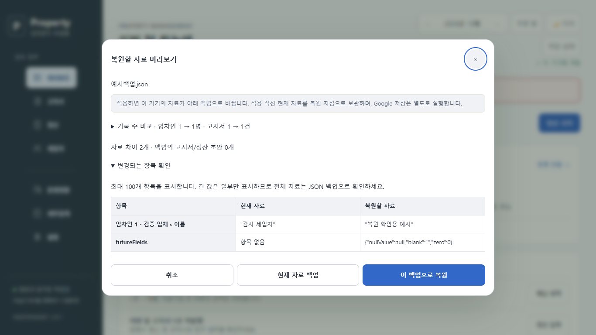
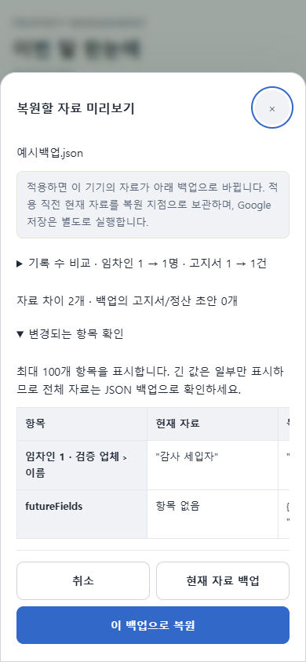

### 후보와 사용

- 최신 예시 미리보기: http://127.0.0.1:4276/?demo=1. 이전 예시 탭의 미저장 작업과 PWA 캐시를 지우지 않도록 별도 개발 포트에서 열었다. 원격 서비스는 동일 URL을 유지한다.
- [GAS 2.0.1 후보 ZIP](../releases/rental-independent-gas-2.0.1.zip)과 [파일별 해시](../releases/gas-candidate-2.0.1.json).
- 기존 APK, 2.0.0 후보 ZIP/manifest와 기준 릴리스 기록은 보존했다. 2.0.1 웹 변경은 Android native 코드를 바꾸지 않으므로 APK 재빌드를 수행한 것으로 보고하지 않는다.
- 실제 독립 GAS 소스와 배포를 다시 읽어 기존 기준과 동일함을 확인했다. 현재 운영은 소유자 전용 버전 4다. 2.0.1을 운영에 반영하지 않았다.
- 롤백과 운영 승인 절차는 기존 [릴리스 후보 문서](RELEASE_CANDIDATE_V2.md)를 따른다. 2.0.1을 반영할 때는 해당 버전 ZIP/해시와 최신 검증 요약을 승인 대상에 사용한다.

### 다음 작업 순서

1. Google 자료 불러오기 비교·취소와 dirty/baseRevision/Docs·Calendar 경계는 위의 2.0.2에서 보완했다.
2. 백업·초안 손상 진단을 강화한다. 유효하지 않은 메타데이터를 어떻게 보관·안내할지 정리하고 정상 자료를 조용히 바꾸지 않는다.
3. 일곱 업무 화면의 키보드·포커스·문구·대비를 추가 점검한다. 실제 스크린리더와 휴대전화 검증은 별도로 남긴다.
4. 운영 승인이 있을 때 소유자 로그인·실제 정상 저장·문서·기존 Calendar ID·Android 종단 흐름을 확인한다.

부분입금 원장·계약 적용일·데이터 스키마 변경, 실제 Google 쓰기, 운영 배포 및 APK 공개 배포는 이 로컬 보완에서 자동으로 실행하지 않는다. 지속 개선 목표는 활성 상태로 유지한다.
