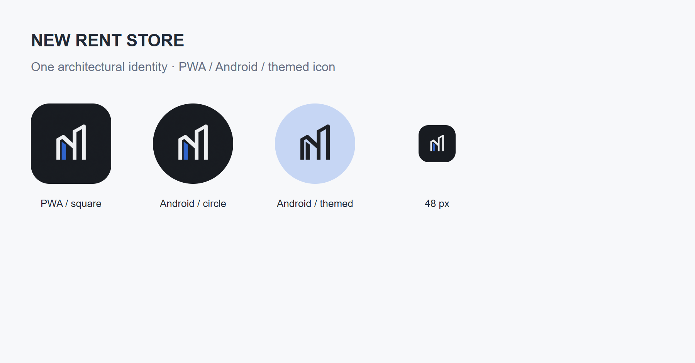

# NEW RENT STORE 아이콘 업데이트 — Android 4.1.2 / 웹 2.3.1

Google Drive의 [HENRY Design Profile v3.0](https://docs.google.com/document/d/1urPo9Fi4OIQlChqF4eHhGi1367E-TRxZR0dbwAiJtjY/edit)와 [Design Charter v2.0](https://docs.google.com/document/d/1V1NNoGfL03oO6c8dhlLYNOk_0x4Ijijcmg0uF5dFg0k/edit)를 확인했다. 절제된 고급스러움, Pure Graphite, 간결한 선형 표현과 Pretendard 우선 선호를 반영했다. 홈 화면의 다크 선호를 앱 전체의 다크 테마로 확대하지 않았다.

건물의 입면과 NEW의 N을 하나의 심벌로 구성했다. 흑연색·오프화이트에 기존 앱의 파란색 포인트를 한 곳만 사용한다. 작은 아이콘에서 읽기 어려운 앱 이름은 넣지 않았다. 원본과 전체 생성 프롬프트는 [브랜드 원본 폴더](../icons/branding-4.1.2/PROMPT.md)에 보관한다. 내장 이미지 생성 도구로 제작했으며 기존 Sharp 개발 도구로 플랫폼별 크기와 Android 테마용 알파 마스크를 내보냈다. 앱 실행 의존성은 추가하지 않았다.

PWA 192/512·maskable 512·Apple 180·favicon·웹 사이드바와 APK의 기존/적응형/Android 13 이상 테마 아이콘을 같은 원본으로 통일했다. manifest 식별자와 시작 주소·범위는 유지했다. PWA 캐시를 2.3.1로 올려 새 정적 자산을 함께 받는다. APK는 같은 패키지와 서명을 사용하는 4.1.2 / versionCode 7이다. 기존 앱에서 설정 → 앱 업데이트 → 업데이트 확인으로 설치한다. Android의 설치 확인은 사용자가 승인한다.

Pretendard, 기존 라이트 작업 화면, 계약·정산·출력·백업, 4.1.1의 연결 대기 개선, 임대 데이터와 인증·권한은 유지한다. 서버 변경은 앱 버전 안내와 웹 화면 아이콘 자산에 한정한다.

검증 및 운영 반영 결과는 `releases/native-4.1.2-validation.json`에 기록한다. 실제 휴대전화와 One UI 홈 화면의 최종 표시·PWA 설치 아이콘의 갱신 시점은 별도 기기 확인이 필요하다.

## 운영 반영·검증

- Node 225개, PWA 6개, Android 단위 1개 및 서명 release 빌드·lint 통과. lint는 오류 0개·경고 7개이며, 신규 경고는 v26 적응형 자원에 대한 monochrome 검사다. 실제 v33 자원에는 테마용 마스크가 포함된다.
- PC 1366px·모바일 390px에서 브랜드와 가로 넘침을 확인했다. 48px·원형·사각형·단색 마스크와 적응형 안전 영역을 확인했다. API35 에뮬레이터의 실제 설치 화면과 런처도 캡처했다.
- 실제 배포 4.1.1에서 앱 내부 업데이트로 4.1.2 설치 및 암호화 보관 자료·최초 설치 시각 보존을 확인했다. 첫 시도는 연결 시간 초과였고 재시도는 43.5초에 설치 확인 화면까지 통과했다. 안정적인 모든 네트워크의 시간을 보장하는 결과는 아니다.
- 소유자 GAS 14 / Android API 7 / 라이브러리 14. 기존 주소·접근 정책·Google 범위·임대 로직을 유지했고 운영 시트 내용이 배포 전후 같다.
- APK의 로컬·GAS 실제 다운로드·Drive·설치본 해시가 같다. [Drive APK](https://drive.google.com/file/d/1RLFgXBfE4wbh8ZPMC4w-OnkKN-Jy4Xjh/view?usp=drivesdk) · [GitHub 릴리스](https://github.com/ldjkorea/NEW-RENT-STORE/releases/tag/v4.1.2).
