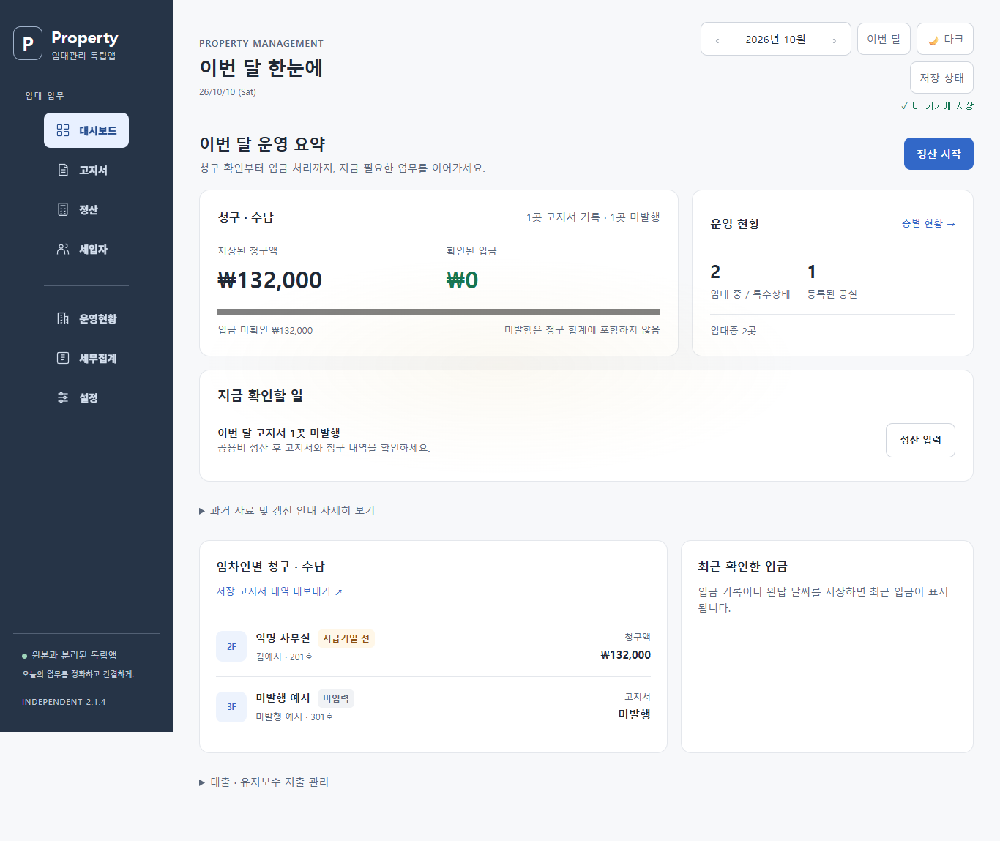
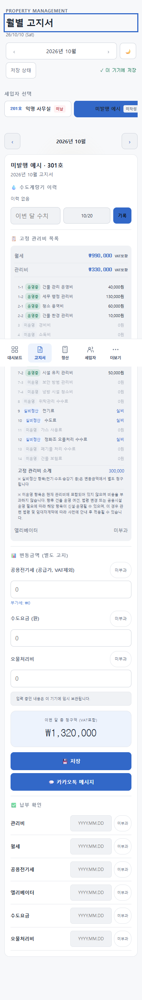

# 미발행 고지서와 월별 CSV — 웹 2.1.4

월별 CSV는 선택한 월의 **저장된 고지서**만 내보낸다. 등록된 임차인에게 고지서가 없거나 고지서 객체가 비어 있으면 현재 월세·관리비를 청구액으로 넣지 않는다. 저장 고지서가 있는 보관 임차인과 미등록 임차인은 계속 포함한다. 금액·납부 계산과 기존 CSV의 16개 열·순서·파일명·텍스트 이스케이프는 유지한다.

## 확인한 문제와 변경

2.1.3의 월별 CSV는 `bill || {}`로 빈 값을 계산해, 고지서가 없는 임차인에게도 현재 월세·관리비를 넣었다. 앞서 확보한 독립 운영 JSON의 11개월을 로컬 Edge에서 실제로 내려받아 확인한 결과 2개월에서 총 6개 추가 행이 생겼다. 저장 고지서는 총 38건인데 CSV 행은 44개였다. 수정 후에는 11개월 모두 저장 고지서 행 수와 합계가 일치한다. 이 비교는 기존 Git `e08f915`의 화면과 새 화면을 별도 로컬 서버에서 실행했으며 Google에 쓰지 않았다.

백업에 빈 고지서 객체가 있는 익명 사례에서는 재실행 시 초기화가 그 빈 객체에 현재 청구 기준을 채우는 문제도 발견했다. 이제 초기화는 비어 있지 않은 고지서만 보완하며, 빈 객체는 그대로 유지한다. 월별 고지서의 선택 표시도 **미작성**으로 맞췄다. 빈 항목을 선택하면 작성 화면을 열고, 저장된 고지서의 입금·정정 버튼을 표시하지 않는다. 사용자가 고지서를 저장할 때 기존 저장 흐름을 사용한다.

대시보드 내보내기 버튼을 **저장 고지서 내역 내보내기**로 바꿔 출력 범위를 표시했다. 저장 고지서가 없는 월의 CSV는 열 제목만 담는다. 원본 자료에 남은 과거 추정 표시 30건은 확정하지 않았으며 원래 고지서·계약 자료 대조가 필요하다.

## 검증 흐름

`tests/restored-data-browser.cjs`는 기본적으로 익명 자료를 사용한다. PC와 모바일에서 백업 미리보기 취소·적용·재실행·JSON 내보내기, 모든 저장 고지서의 항목과 총액, 추정 기준 확인 체크의 초기 미확인 상태, 월별/분기 CSV와 화면 집계, 미발행 입력 화면, 6개 화면 크기의 7개 메뉴를 검사한다. 고지서를 읽거나 출력한 뒤 저장 원문과 화면 자료가 같은지도 확인한다. 다른 앱의 저장 키는 보존한다.

소스 `9ab701f`의 최종 전체 검사에서 단위 **178/178**, 브라우저 묶음 **12/12**(익명 복원 6개 포함), 별도의 실제 자료 복원 **6/6**이 통과했다. 전체 브라우저 수행 시각은 2026-10-09T23:41:54.709Z–23:47:13.899Z다. 두 익명 화면은 최종 ‘미작성’ 표시까지 포함하며 PC·모바일에서 직접 확인했다.

```powershell
npm run test:all
```

개별 확인은 Playwright와 Edge가 있는 환경에서 `node tests/restored-data-browser.cjs`로 실행한다. 이 검사는 전체 브라우저 묶음에도 포함한다. 전체 검사 명령은 `RENTAL_RESTORE_INPUT`을 전달하지 않아 실제 자료가 일반 회귀 검사에 섞이지 않는다.

개인 자료로 별도 로컬 대조하려면 입력을 이 저장소 `.private` 안에 두고 다음처럼 실행한다. 입력은 앞선 [읽기 전용 대조](OPERATING_DATA_RECONCILIATION.md)의 Sheets JSON·저장 envelope 또는 백업 형식을 지원한다. `.private` 밖의 실제 입력 경로는 거절한다.

```powershell
$env:RENTAL_RESTORE_INPUT='.private/input.json'
node tests/restored-data-browser.cjs
Remove-Item Env:RENTAL_RESTORE_INPUT
```

상세 결과·오류·검사용 백업은 새 `.private/restore-browser-*` 폴더에 보관한다. 실제 자료의 스크린샷이나 금액·임차인 정보를 로그에 출력하지 않는다. 모든 외부 요청을 차단하고 Google 연결을 끈 별도 임시 브라우저 프로필에서만 복원을 적용한다. 실제 운영 시트·문서·Calendar, 사용자 기존 브라우저 프로필과 원본 입력 파일에는 쓰지 않는다. 이 로컬 복원은 Google의 실제 운영 저장·새 입금 원장 운영 복구·휴대전화 설치·오프라인 검증을 대신하지 않는다.

## 운영 상태

웹 소스 2.1.4는 로컬 개발 후보이며 마지막 별도 운영 확인에서 Google 앱은 1.0 / 배포 버전 4를 유지했다. 기존 2.1.3 GAS 검토 ZIP과 해당 검증 기록은 보존한다. 2.1.4의 전체 회귀 결과와 실제 자료 복원 증거는 [개발 검증 기록](../releases/development-2.1.4.json)에 보관한다. 후속 [GAS 2.1.4 검토 ZIP](GAS_REVIEW_CANDIDATE_2.1.4.md)을 생성하고 그 압축본의 익명 복원·CSV 검사도 통과했으며 운영에는 배포하지 않았다.

예시 미리보기: http://127.0.0.1:4287/?demo=1. 이전 포트의 입력·설치 캐시는 지우지 않는다.



