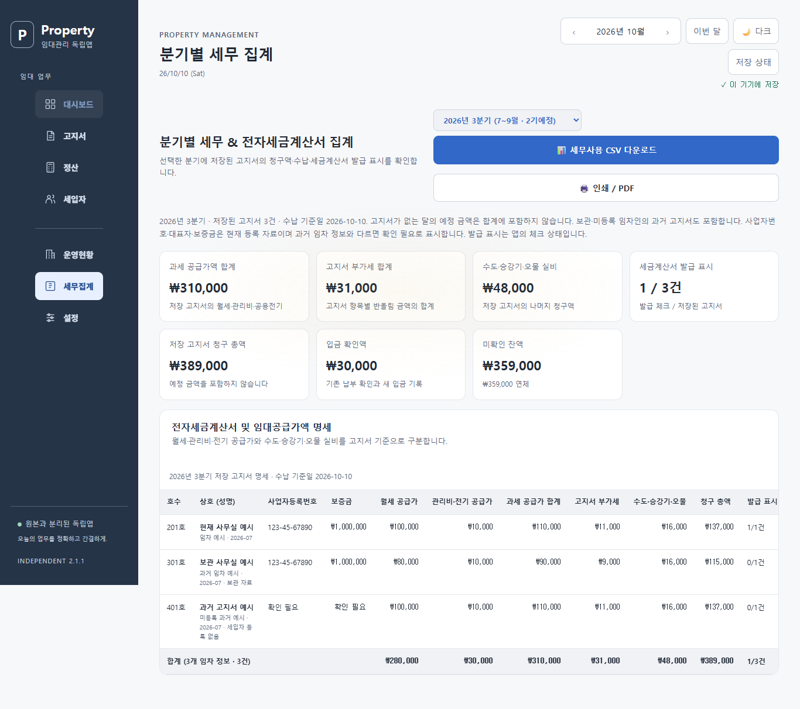
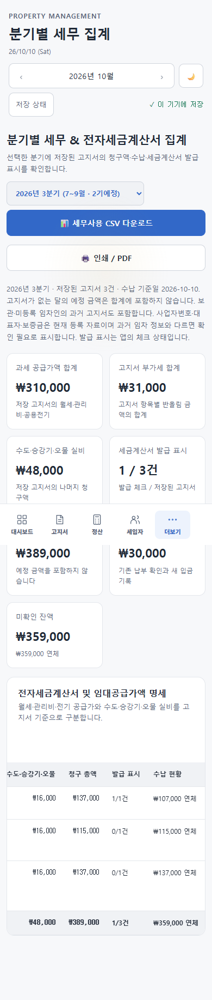

# 분기 고지서 집계 — 웹 2.1.1 개발

## 집계 기준

선택한 분기의 **저장된 고지서**를 모은다. 고지서가 없는 달의 현재 임대료를 예정 매출로 더하지 않는다. 고지서를 저장한 사실과 전자세금계산서의 `invoiceIssued` 체크 상태를 구분한다. 체크 표시는 외부 발급 서비스의 실제 발급 확인 결과가 아니다.

7월 고지서만 있는 예시에서 월세 공급가 100,000원·관리비 공급가 10,000원·수도 10,000원이라면 집계 총액은 131,000원이다. 기존 화면과 CSV는 고지서가 없는 8·9월의 현재 월세·관리비도 더해 373,000원과 발급 표시 `1/3건`을 출력했다. 변경 후에는 131,000원과 `1/1건`을 표시한다. 변경 전 실제 로컬 브라우저 CSV로 오류를 재현했다.

`RentalBilling.quarterlyStatement(tenants, bills, year, quarter, asOf)`는 DOM·저장소·네트워크 없이 조회 결과를 만든다. 클라이언트와 생성한 `server/Billing.gs`가 같은 소스를 사용한다. 화면·CSV·인쇄는 이 결과를 사용하며 집계나 분기 선택 때문에 고지서·납부 이력·초안·원문을 저장하지 않는다.

## 금액과 수납

- 월세·관리비·공용전기의 공급가를 구분하고 부가세는 고지서 항목별 최종 청구액과 공급가 차이를 합산한다. 분기 공급가 총합에서 다시 반올림하지 않는다.
- 수도·승강기·오물 청구액을 모두 포함한다. 미부과 항목과 1층 승강기 제외 등 기존 고지서 계산 규칙을 유지한다. 세금 분류를 새로 판정하는 기능이 아니다.
- `청구 총액 = 공급가 + 고지서 부가세 + 나머지 청구액`, `청구 총액 = 입금 확인액 + 미확인 잔액`을 유지한다. 합계가 JavaScript 안전 정수 범위를 벗어나면 반올림한 값으로 출력하지 않고 집계를 중단한다.
- 수납 기준일을 표시한다. 기존 납부 확인과 새 원장 입금을 공유 수납 계산으로 합산한다. 확인액을 전부 실제 현금 매출로 바꾸지 않는다.
- 연체, 납기 전, 납기 미지정을 구분한다. 연체액이 0이어도 잔액이 있으면 전액 확인으로 표시하지 않는다. 청구액 자체가 0인 고지서는 청구 금액 없음으로 표시한다.
- 입금 정정은 기존 기록을 지우지 않고 새 사유 기록으로 처리한다. 정정 후 분기 화면·CSV의 확인액과 잔액이 함께 바뀐다.

## 과거 임차 정보와 등록 정보

보관한 세입자와 현재 세입자 목록에 없는 고지서도 포함한다. 고지서의 호실·성명·상호를 사용하며, 동일 세입자 ID라도 과거 임차 정보가 다른 경우 별도 행으로 구분한다. 현재 등록 이름으로 과거 행을 바꾸지 않는다. 원본에 없던 값이 보완된 고지서는 확인 필요 표시를 유지한다.

과거 고지서에는 사업자등록번호·대표자·보증금 snapshot이 보통 없다. 고지서의 호실·성명·상호가 현재 등록 자료와 같을 때만 현재 등록 값을 사용하고 그 출처를 표시한다. 정보가 바뀌었거나 세입자 등록 자료가 없으면 해당 값은 확인 필요로 남긴다. 현재 번호나 보증금을 과거의 확정 값으로 저장하지 않는다. 고지서에 보관된 임차인 성명은 CSV에도 별도로 포함한다.

## CSV와 화면

기존 CSV의 앞 13개 열 순서를 유지한다. 제목은 현재 등록 정보와 저장 고지서 기준임을 드러내도록 바꿨으며, 발급 표시의 분모는 저장된 고지서 건수다. 뒤에 입금 확인액·잔액·납기 전/미지정 잔액·고지서 월·수납 기준일·등록 정보 출처·과거 기준 확인 표시·고지서 임차인 성명을 추가한다. CSV 열 수는 22개다. 이전 열 제목이나 전체 열 수에 의존하는 수작업 양식은 새 제목을 확인해야 한다. JSON 백업 형식과 기존 자료는 변경하지 않는다.

금액은 원 단위 숫자로 내보내며 텍스트의 따옴표는 CSV 규칙에 맞게 보존한다. 공급가·부가세·실비·확인액·잔액은 화면과 같은 집계 결과다. 분기에 고지서가 없으면 금액 행 없이 제목만 내보낸다.

PC와 모바일에서 합계는 카드로 표시한다. 명세표는 가로 스크롤 영역을 사용하며 키보드 방향키로도 움직일 수 있다. 큰 글꼴 설정은 표에도 적용한다. 인쇄용 스타일은 A4 가로 방향과 전체 열 표시를 사용하며, 인쇄 후 일반 화면 상태로 돌아온다. 실제 프린터 출력이나 실제 휴대전화에서 검증한 결과는 아니다.

## 운영 경계

이 기능은 웹 2.1.1 로컬 개발 소스다. 운영 Google 주소는 기존 앱 1.0·배포 버전 4를 유지한다. 운영 시트의 실제 전체 금액 대조, Google에 대한 2.x 저장/재조회/문서 갱신과 휴대전화·스크린리더·프린터 검증은 남아 있다. 기존 2.0.6 후보 ZIP과 2.1.0 입금 원장 검증 자료는 보존한다. 실제 운영 배포와 외부 자료 변경은 사용자 승인 범위에서 별도로 진행한다.

## 로컬 검증

`npm run test:all`에서 단위 검사 147/147, 브라우저 묶음 9/9, 기존 audit 69/69, 입금 화면 11/11, 분기 화면 8/8을 확인했다. 새 단위 검사 8개는 저장 고지서만 합산, 보관/미등록/변경된 임차 정보, 항목별 부가세·오물·미부과, 숫자 문자열·nullable 원문 보존, 부분입금·납기 상태, 등록 정보 출처·입력 검증, 생성 GAS 일치와 합계 안전 정수 범위를 검사한다.

새 분기 브라우저 검사 8개는 한 달/빈 분기, 과거 임차 정보, 부가세·전체 비용·미부과의 화면/CSV 일치, 납기 전/미지정 잔액, 입금 사유 정정, 6개 화면 크기와 큰 글꼴·키보드 스크롤, 인쇄 스타일·상태 복귀를 검사한다. 원본 저장소·독립 자료·납부 이력은 조회/내보내기 전후 일치했다. 모든 외부 요청은 차단한 별도 Edge 테스트 프로필을 사용했다.

검증 소스는 `c595d30`이다. [개발 검증 요약](../releases/development-quarter-2.1.1.json)에 수행 시각과 소스·화면 파일의 SHA-256, 운영 배포 유지 및 남은 범위를 기록한다.
