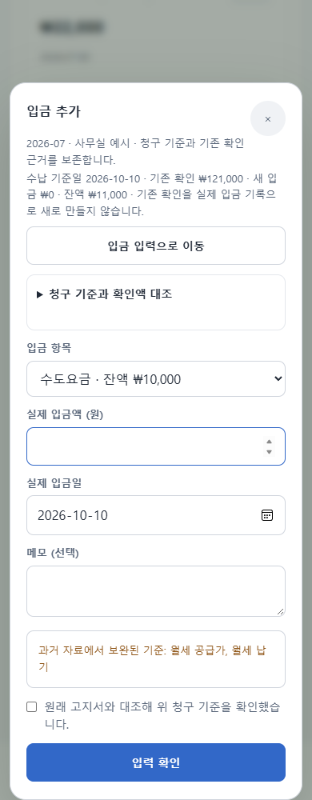
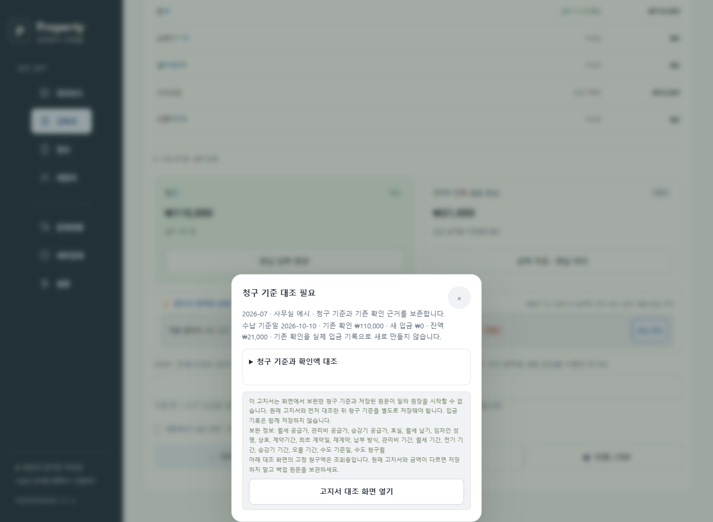

# 입금 원장 시작 전 청구 기준 대조 — 웹 2.1.2 개발

## 확인할 내용

고지서의 **금액별 입금 기록 시작**을 열면 저장된 호실·임차인·상호·월세 납기·계약기간과 여섯 항목의 청구액·확인액·잔액을 확인할 수 있다. 월세·관리비·전기·승강기·수도·오물의 청구액은 기존 계산의 부가세 포함 금액이다. 미부과 항목은 청구·확인·잔액을 0원으로 표시한다. 현재 등록 정보가 바뀌어도 고지서에 저장된 과거 정보를 사용한다.

청구 기준과 확인액 대조 목록은 최초 원장 개시에서 펼친다. **입금 입력으로 이동**을 누르면 목록을 접고 입금액 입력칸에 포커스를 옮긴다. 이 동작은 자료를 저장하거나 대조 확인 체크를 대신하지 않는다. 이미 원장이 있는 경우 목록은 접힌 상태로 시작하며, 열면 현재 입금·정정을 반영한 확인액과 잔액을 확인할 수 있다. 준비한 입금의 검토 화면에서 이동 버튼을 누르면 입력 수정 버튼으로 이동하며 준비한 기록을 자동 변경하지 않는다.

목록을 열고 닫는 동안 고지서·원장·입금·초안·원문·동기화 기준을 저장하지 않는다. 항목의 계산은 `RentalBilling.receiptLedgerState`를 그대로 사용한다. 별도의 입금 배분이나 새로운 세금 계산을 만들지 않는다.

## 기존 확인과 날짜

상단과 항목별 내역에 같은 수납 기준일을 적용한다. 기존 확인은 과거 납부 표시의 근거이며 원장 개시일에 새 실제 입금이 생긴 것으로 기록하지 않는다. 날짜가 없는 도장은 날짜 미지정으로 남기고, 짧은 기존 날짜는 해당 고지서 연도로 표시한다. 원문 날짜와 nullable 메타데이터는 보존한다.

기존 2.1.1의 실제 로컬 브라우저에서 미래 `2199/07/05` 월세 확인이 공유 현재 수납 계산에서는 0원인데, 원장 시작 문구에서는 110,000원으로 표시되는 것을 재현했다. 기존 문구가 모든 날짜의 확인을 합산하던 문제다. 이제 상단과 항목에서 현재 기준일의 확인액 0원을 표시하며, 원장에 보존할 미래 확인 날짜는 별도 문구로 보여준다. 미래 확인을 삭제하거나 날짜를 오늘로 바꾸지 않는다. 원장의 초과입금 보호와 기존 날짜 검증은 유지한다.

과거에 보완된 청구 기준은 월세 공급가·관리비 공급가·호실·월세 납기·성명·계약기간 등 한국어로 표시한다. 모르는 항목은 확인 항목으로 표시하며 사용자 문자열을 HTML로 실행하지 않는다. 확인 체크 후에도 원래 `snapshotEstimated`와 원장 `estimatedFields` 이름 목록은 그대로 보관한다.

## 저장 원문 대조가 필요한 고지서

앱이 조회를 위해 누락 기준을 보완한 고지서는 기기에 저장된 원문과 화면의 기준이 다를 수 있다. 원장 시작 전에 기존 `RentalCore.assertReceiptStorage` 검증을 읽기 전용 후보에 적용한다. 원장 개시와 기존 청구 기준 변경을 한 번에 저장할 수 없는 경우에는 **청구 기준 대조 필요**를 표시하고 입금 입력·확인·저장을 제공하지 않는다. 계산·원문 검증 자체의 다른 오류는 정상 개시로 바꾸지 않는다.

**고지서 대조 화면 열기**는 기존 고지서 수정 화면으로 이동한다. 이동만으로 저장하지 않는다. 원래 고지서와 금액이 같다는 확인 후 기존 저장 버튼으로 청구 기준을 별도로 저장하고, 다시 입금 원장을 시작한다. 단위·메타데이터·기존 납부 확인은 이 과정에서 임의로 입금 기록으로 나누지 않는다. 다른 창이 자료를 저장했다면 이동을 중단하고 최신 자료 확인을 안내한다. 검토 후 실제 원장 저장에서도 기존 원문·창 간 충돌 검사를 반복한다.

현재 고지서 수정 화면의 고정 청구액은 조회용이다. 과거 월세·관리비·승강기 공급가가 원래 고지서와 다르면 이 화면에서 값이 수정된다고 가정하지 않는다. 과거 금액과 계약 정보를 수정·이력 보존·납부 근거 대조하는 별도 흐름은 후속 작업이다. 이미 원장이 시작된 고지서의 고정 청구 기준을 바꾸는 이관 정책도 남아 있다. 이 안내 개선을 전체 이관 완료로 보고하지 않는다.

## 검증 범위

새 로컬 Edge 시나리오 8개로 PC/모바일의 항목 합계·저장된 과거 임차 정보, 읽을 수 있는 추정 목록·HTML 실행 방지·추정 원문 보존, 저장 전 안내·원문 유지, 별도 수동 저장 후 실제 입금 한 건, 미래 날짜의 현재 확인액, 기존 원장의 잔액과 취소 시 보존, 6개 화면 크기/100%·200% 글꼴/키보드 이동, 다른 창 변경 후 대조 화면 이동 중단을 검사한다. 모든 외부 요청은 차단한 익명 자료의 별도 프로필을 사용한다.

최종 `npm run test:all`에서 단위 검사 147/147, 브라우저 묶음 10/10, audit 69/69, 기존 입금 화면 11/11, 대조 화면 8/8, 분기 집계 8/8을 확인했다. 빌드·문법·생성 파일 일치도 통과했다.

검증 소스는 `1db025d`이다. [개발 검증 요약](../releases/development-receipt-basis-2.1.2.json)에 수행 시각, 시나리오 결과, 파일 해시와 미완료 범위를 기록한다.

실제 Google 운영은 앱 1.0·배포 버전 4를 유지한다. 이번 기능의 실제 Google 저장·Docs 재생성·Calendar 동기화·운영 배포·Android 재빌드·휴대전화·스크린리더 검증은 수행하지 않는다. 기존 2.0.6 후보 ZIP과 앞선 2.1.0/2.1.1 개발 검증 기록은 보존한다.
