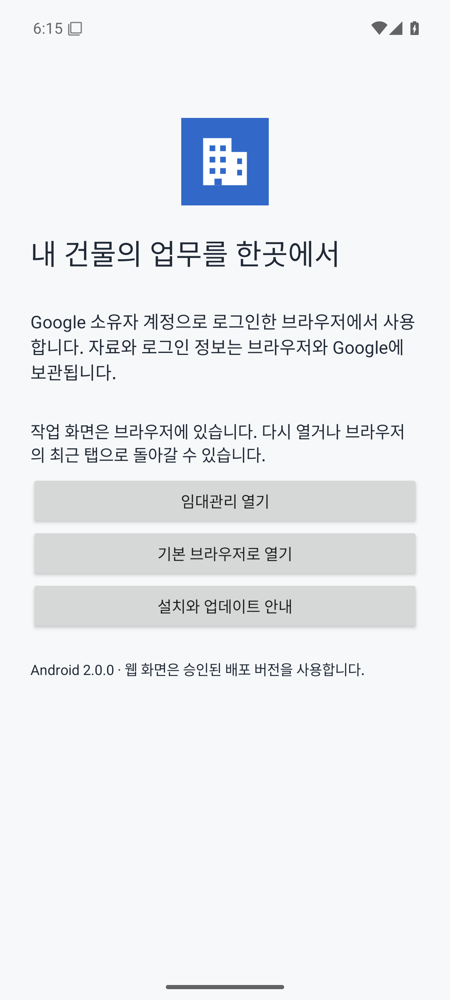

# 임대관리 독립앱 2.0 — 릴리스 후보

작성: 2026-10-10 KST. 대상은 독립앱이며 운영 Google 자료와 기존 원본을 변경하지 않는 로컬 후보다.

## 결과와 판정

| 게이트 | 판정 | 확인한 범위 / 한계 |
|---|---|---|
| SOURCE READY | PASS | 실행 가능한 2.0 소스, 결정적 단일 HTML·Billing.gs 빌드, 문법 검사, 로컬 Git 커밋 |
| DATA VERIFIED | PASS — 격리 검사 및 운영 읽기 대조 | 102 단위 검사, 모의 동시 접근·재시도·실패 주입, 전체 도메인/null 보존. 실제 2.0 Google 쓰기는 NOT TESTED |
| UX VERIFIED | PASS — 로컬 PC/모바일 | 6개 뷰포트, 일곱 메뉴, 200% 글꼴, 긴 금액/상호, 입력·완납·정산·복원. 실제 음성 스크린리더·휴대전화 성능은 NOT TESTED |
| APK BUILD READY | PASS | release 빌드, lint 0 errors / 1 warning, 단위 1건, v1/v2 서명·패키지·버전·SHA-256 확인 |
| DEVICE VERIFIED | PASS — 에뮬레이터의 native/browser 경계 | API 35 전용 에뮬레이터: Chrome 진입·회전·뒤로가기·재진입 instrumentation 1건, 서명 release 설치·동일 버전 재설치. 소유자 로그인·실제 폰·외부 문서 링크는 NOT TESTED |
| DEPLOY READY | PASS — 승인 검토 가능한 후보 | 8개 GAS 파일·해시·롤백 절차 준비. 실제 독립 운영 배포 교체는 미수행, 소유자 인증 및 쓰기 검증은 승인된 반영 후 수행 |

현재 로컬 검사에서 FAIL은 0건이다. 이것은 실제 Google 장애·데이터 손실 가능성 전체가 사라졌다는 뜻이 아니다. 미검증 범위를 제품 출시 전 확인 항목으로 유지한다. 사용자 명세의 운영 승인 게이트 때문에 외부 배포는 실행하지 않았다.

## 사용할 산출물

- 현재 운영 앱: https://script.google.com/macros/s/AKfycbzclS1FDsLvKEpojsGrQ9eh4dDrjpWP1OFeG2e4RG3LjmtVR7hQRCAutBoSMoXGmgae/exec — 기존 승인된 **1.0 / 배포 버전 4**
- 열어 둔 2.0 예시 미리보기: http://127.0.0.1:4275/?demo=1 — Google 연동 없음, 실제 자료와 별도 예시 저장소
- [서명 APK](../releases/rental-independent-2.0.0.apk)
- [GAS 후보 ZIP](../releases/rental-independent-gas-2.0.0.zip) — 서버 7개 파일과 App.html, 운영 자료/키 없음
- [APK 릴리스 manifest](../releases/release-manifest.json), [SHA256SUMS](../releases/SHA256SUMS.txt), [GAS 파일별 SHA-256](../releases/gas-candidate-manifest.json)
- [UX 및 화면](UX_REDESIGN_V2.md), [무결성 감사·복구](DATA_INTEGRITY_AUDIT.md), [Android 업데이트](ANDROID_UPDATE_STRATEGY.md), [후속 개선](PRODUCT_IMPROVEMENT_ROADMAP.md)

APK와 ZIP은 로컬 파일이며 원격 공개나 Drive 업로드는 하지 않았다. APK를 휴대전화로 옮기는 방법은 Quick Share, USB 또는 사용자가 관리하는 비공개 Drive를 이용한다. APK를 압축 해제하지 말고 Downloads에서 연 뒤 Android의 설치 확인을 완료한다. 기존 Google 소유자 계정으로 로그인한 Chrome/기본 브라우저를 사용한다.

## APK 기록

- 앱: 임대관리 독립앱, 건물 아이콘
- package: kr.henry.rental.independent
- versionName: 2.0.0 / versionCode: 1
- minSdk: 23 (Android 6), targetSdk: 37
- 크기: 1,952,983 bytes
- APK SHA-256: `f0f9715c31cb32b27cf129e8a4810aa936859d33446626f1c9ed090ce5dd5624`
- 공개 서명 인증서 SHA-256: `b25160850067d115c493fe51aca9bdce1956d999ed45cee0950bd86d33c5a2a0`
- GAS ZIP SHA-256: `e109b03b17f7ff5b24dfbede98ca57246ead302b39607014b1424090e9245549`

apksigner는 v1/v2 서명을 검증했다. v3/v4와 SourceStamp는 사용하지 않았다. APK는 Custom Tabs를 열며 WebView·비밀번호·Google 쿠키를 저장하지 않는다. 네트워크 상태 권한만 요청한다. package와 비공개 서명키를 유지하고 다음 APK의 versionCode를 증가시켜야 업데이트할 수 있다. Play 배포와 자동 바이너리 다운로드는 미구현이다.

서명키와 서명 설정은 Git에서 제외된 .private/에 있다. 별도 안전한 비공개 백업이 필요하며 새 컴퓨터에서 다른 키를 생성하여 대체하지 않는다. .private/의 실제 임대 자료·OAuth 설정을 공유하거나 커밋하지 않는다.

새 에뮬레이터는 Chrome 최초 설정 화면에 도달했다. Chrome 약관/새 계정 로그인은 처리하지 않았으므로 Google 소유자 인증과 웹 저장까지의 Android 종단 검증은 NOT TESTED다. 데스크톱의 기존 승인된 1.0 운영 앱 접근은 실제 확인했다.

## 로컬 Git 기록

- 개발 브랜치: work/independent-v2
- 이전 기준: 5978818 / backup/independent-v1-5978818
- UI·데이터 안전성·회귀 검사: d4c01a5
- Android 소스·기기 검사: 8bc9c37
- 릴리스 문서와 공개 검증 요약은 후속 문서 커밋에 포함한다. 모든 커밋은 로컬이며 원격 push는 하지 않았다.

## 검사 기록

| 검사 | 결과 |
|---|---|
| npm run build | PASS |
| npm run check:build | PASS — index.html 및 Billing.gs 소스 일치 |
| npm run check | PASS |
| npm test | PASS 102 / FAIL 0 |
| npm run test:independent | PASS 7 시나리오 |
| npm run test:all | PASS — 7 browser suites 모두 exit 0 |
| HTTP / file 단일 HTML | PASS — 6개 뷰포트 각각 검사, PC·모바일 주요 업무 왕복 |
| 사용자 정의 무결성 브라우저 | PASS — 충돌·응답 유실·오프라인·초안·역전·복원·6개 뷰포트·200% 글꼴·대량 렌더 |
| 정산 초안 JSON 및 quota | PASS — 초기화/복구 왕복과 저장 실패 후 초안 내보내기 |
| Gradle assembleRelease / lintRelease / testDebugUnitTest | PASS |
| native instrumentation | PASS 1 / 실제 Google 로그인 NOT TESTED |
| 서명 APK 설치 / 동일 버전 재설치 | PASS — emulator-5556 |

기준 5978818은 단위 85건·독립성 7건 통과와 상속된 브라우저 실패 7건을 재현했다. 낡은 선택자·문구·VAT 모드·수동 배분 시나리오·캐시 기대값을 현재 동작에 맞추고, 실제 충돌 및 작은 터치 영역 결함을 수정했다. 검사 삭제나 실 운영 자료를 이용한 테스트 초기화는 하지 않았다.

102 단위 검사와 브라우저 시나리오는 서로 다른 집계다. 브라우저 suite에는 여러 반복 뷰포트/업무 검사가 포함되어 있으며 단위 건수와 합산하지 않는다. 500명 익명 데이터의 마지막 renderAll 측정은 test-results/integrity-v2/results.json에 기록한다. 개발 PC 측정이며 저사양 휴대전화 속도 보장은 아니다.

로그: .private/v2-final-all.log, .private/v2-final-independent.log, .private/android-final-build.log, .private/android-independent-device-test.log, .private/android-release-signature.log. 공개할 수 있는 요약은 releases/validation-summary.json에 보관한다. lint의 유일한 경고는 UIAutomator 테스트 라이브러리의 신규 버전 안내다. Gradle 10 호환성 관련 deprecated 안내도 남아 있으며 사용한 Wrapper는 9.6.1이다.

재실행에는 Node 20 이상, Playwright와 Edge, Android용 JDK/SDK가 필요하다. 이번에는 기존 Codex 번들 Playwright를 NODE_PATH로 연결했다. 새 웹 런타임 의존성은 추가하지 않았다. 다른 PC에서는 tests의 Edge 경로나 RENTAL_BROWSER와 로컬 SDK/JDK 설정을 준비한다.

## 원본·운영 보호 근거

- 원본 활성 시트 원문은 초기 복제 당시 비공개 기준과 완전히 같았다.
- 현재 원본/독립 시트의 도메인은 동일: 임차인 4명, 고지서 월 11개. 두 저장 envelope의 receipts 메타데이터는 별개다.
- 현재 자료에 구/신 validator를 적용해 도메인 차이 0건을 확인했다.
- 원본 GAS 소스·배포는 최초 읽기와 동일했다. 원본 Doc 최종 수정일 2026-10-04 유지.
- 독립 운영 GAS의 8개 파일과 배포 설정은 2.0 시작/종료 읽기가 동일했다. owner-only 버전 4 유지. 복제 Doc 최종 수정일 2026-10-09 유지.
- 2.0 테스트는 실제 시트·Docs·Calendar에 쓰지 않았고 원격 push/공개 범위 변경/Play 업로드도 하지 않았다.

전체 Drive revision 이력과 모든 업무 외 Calendar 이벤트의 무변경을 전수 증명한 것은 아니다. 원본 로컬 저장소 보호는 별도 브라우저 테스트로 검증했다. 비공개 원문은 .private/에만 보관한다.

## 승인 후 운영 반영 및 롤백

1. 대상이 독립 GAS `1n9IWX9Mzu30fZtm_DcMW5SRR69RqxH6BqOo8ydC4jcbPeTLP00UT-EQ4`인지 확인한다. 다른 기기의 편집을 마무리하고 현재 독립 DB 원문·복구 시트·GAS source·Script Properties·Docs/Calendar 매핑을 비공개로 백업한다. 기존 Calendar 4건 ID를 보존한다.
2. App.html과 server/ 파일의 SHA-256을 후보 manifest와 대조한다. 이 파일들만 독립 프로젝트에 반영한다. 시트/문서/Calendar ID와 MYSELF 권한, executeAs USER_DEPLOYING을 유지한다.
3. 새 GAS 버전을 생성해 **기존 독립 배포 ID**에 연결한다. 새 URL이나 공개 접근으로 바꾸지 않는다. DB schemaVersion 1은 유지한다. 이 단계에서 자료를 초기화하거나 Calendar 테스트 일정을 만들지 않는다.
4. 소유자 계정으로 새 앱을 열어 2.0 버전·4명/11개월·전체 도메인을 읽기 대조한다. 사용자 승인 범위에서 실제 정상 편집·저장·재조회·Docs 결과를 검증한다. Calendar 동기화는 기존 4개 event ID가 유지됨을 확인할 수 있는 승인된 정상 동기화로 검증한다.
5. Android에서 소유자 로그인·웹 화면·저장·문서 링크·뒤로가기·재진입을 확인한다. 장시간 열린 1.0 화면은 백업 후 닫고 다시 연다. 웹 업데이트를 적용하는 데 APK 재설치는 필요하지 않다.
6. 2.0 UI/서버 문제가 있으면 기존 배포를 **GAS version 4**로 돌린다. 필요 시 backup/independent-v1-5978818에서 별도 checkout을 만들어 기존 소스를 복구한다. 현재 작업 트리를 강제 reset하거나 자료를 비우지 않는다.
7. DB 또는 Calendar/Docs가 이미 변경되었다면 코드 롤백과 데이터 복원을 동일시하지 않는다. verified recovery 원문·SHA-256·도메인을 검증하고 별도 승인으로 복원한다. 신규 marker와 쓰기 journal을 무작정 삭제하지 않는다.

현재 approval 대상은 위 독립 GAS의 2.0 운영 코드 반영과 승인된 검증 범위다. 원본 프로젝트, 원본 저장소, Play 공개 출시 및 새 자동 업데이트 호스팅은 포함하지 않는다.
