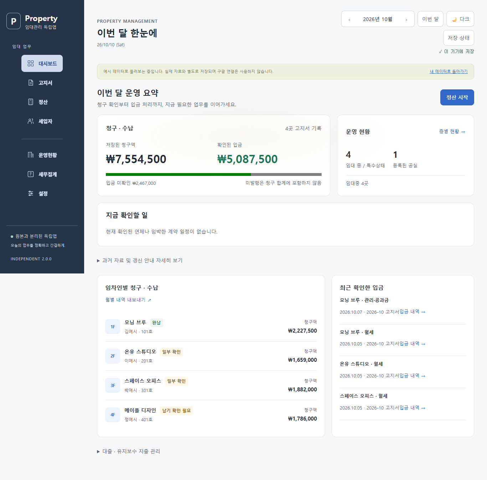
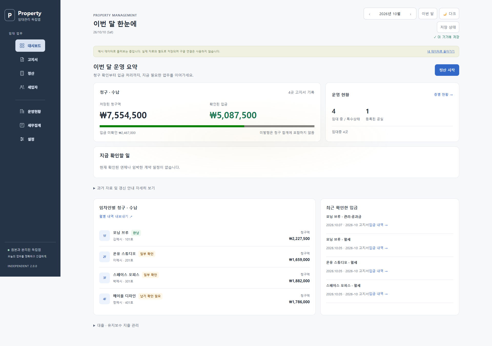
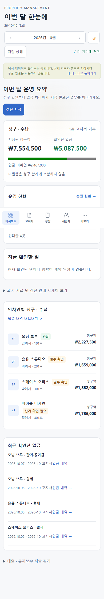

# 임대관리 독립앱 2.0 UX 리디자인

## 기준과 정보 구조

Google Drive의 **[지침] 이동준 개인 선호 디자인 — HENRY UI/UX DESIGN CHARTER v2.0** 실제 본문을 조회했다. 최신 v2.0의 INTUITIVE PREMIUM UTILITY, 라이트 우선, 명확한 업무 흐름, 정확한 저장 상태를 적용했다. 아래 색상은 이번 제품의 구현 선택이며 사용자의 확정된 개인 취향으로 해석하지 않는다.

PC는 좌측 236px 사이드바, 800px 이하에서는 **대시보드 · 고지서 · 정산 · 세입자 · 더보기**의 다섯 메뉴를 사용한다. 더보기에는 운영현황, 세무집계, 설정이 있다. 일곱 화면의 기존 기능과 ID를 유지했다. 보조 메뉴는 Escape로 닫을 수 있고 선택 상태 및 키보드 포커스를 제공한다.

| 흐름 | 진입과 완료 확인 |
|---|---|
| 월별 업무 | 기간 선택 → 청구·수납 요약 → 지금 확인할 일 |
| 입금 확인 | 임차인 목록 → 고지서 → 월세 / 관리·공과금 완납 날짜 → 저장 |
| 고지서 수정 | 저장된 고지서 → 수정 → 금액 검증 → 기기 저장 → 별도 Google 저장 상태 |
| 공용비 정산 | 비용·검침 입력 → 배분 합계 검증 → 확정 → 고지서 반영 |
| 계약 관리 | 운영현황 → 만료 일정·임대상태 → 계약 조건 갱신 → 과거 고지서 보존 |
| 오류 복구 | 저장 상태 → 차이 비교 / 백업 → 최신 자료 확인 → 재시도 |

## 홈의 위계

첫 영역은 저장된 고지서의 청구액과 확인된 입금이다. 미발행 고지서는 합계에서 제외하고 **미발행**이라고 표시한다. 지급기일 전 미확인 금액과 실제 체납은 구분한다. 수납률은 청구액이 있을 때만 표시한다.

두 번째 영역은 실제 임대상태별 등록 현황이다. 임대 중, 재계약예정, 법적 분쟁, 공실·모집 상태를 한 상태로 합치지 않는다. 등록된 공실 수는 등록 자료를 뜻하며 실제 전체 공실을 추정하는 수치가 아니다.

**지금 확인할 일**에는 실제 누적 체납, 고지서 미발행, 임박·경과한 계약 일정, Google 미반영 수정만 나타난다. 체납이 없으면 가짜 경고를 만들지 않는다. 임차인별 청구·수납 목록에서 고지서로 바로 이동한다. 완납 날짜가 기록된 입금만 최근 입금에 표시한다.

과거 자료의 추정·고아 기록·기존 갱신 안내는 펼쳐보기로 제공한다. 대출과 유지·수선 지출도 펼쳐보기로 이동했으며 추가·수정·삭제·이자 계산 기능은 유지했다. 홈에서 반복되던 같은 비중 KPI 다섯 개와 중복 정산 안내를 줄였다.

## 디자인 토큰과 접근성

| 역할 | 구현 |
|---|---|
| Canvas / Surface / Border | #F7F8FA / #FFFFFF / #E4E7EC |
| 본문 / 보조 본문 | #202936 / #596679 |
| 프레임 / 브랜드 강조 | #263447 / #3268C8 |
| 정상 / 위험 / 주의 | #147552 / #B52E36 / #8D5212 |
| 모서리 | 패널 14px, 입력·버튼 9px |
| 글꼴 | 시스템 산세리프, Segoe UI, 맑은 고딕 fallback |
| 터치 / 포커스 | 주요 버튼 최소 44px, 모바일 메뉴 52px, 3px 포커스 링 |

기존 CSS의 다크·골드 기본 토큰과 녹색 workspace 중복 테마를 제거하고 workspace.css에 토큰을 모았다. 다크 테마는 별도 선택으로 유지하며 처음 실행은 밝은 테마다. 기존 저장된 테마 선택은 보존한다. 내비게이션은 같은 선형 SVG 아이콘을 사용한다. 업무 계산은 CSS나 홈 렌더러에서 재작성하지 않았다.

새 UI의 폰트 크기는 rem을 사용하고 모바일 하단 메뉴 높이도 글꼴 크기에 맞춰 늘어난다. 긴 상호·금액은 줄바꿈한다. 입력 라벨을 동적으로 연결하며, 홈 목록은 키보드 Enter/Space로도 열 수 있다. 움직임 줄이기 설정을 존중한다. 일부 기존 상세 안내와 기존 기능의 이모지·인라인 크기 지정은 남아 있다.

## 작업 보존과 상태

선택한 월, 최근 메뉴, 임차인 선택, 건물 필터와 검색어를 독립 저장소에 기억한다. 기존 고지서 초안을 유지하고 정산 초안도 월별로 보관한다. 기준 계약·고지서·정산 자료가 바뀌면 이전 초안을 자동 적용하지 않는다. 정산 초안은 JSON 백업의 별도 메타데이터로 내보내며 임대 DB 필드와 구분한다.

저장 상태 센터는 기기 저장, Google DB 확인, 문서 갱신, Calendar 결과를 각각 표시한다. 조회 시각을 저장 완료 시각으로 표시하지 않는다. 다른 기기의 revision이 바뀌면 차이 비교와 백업·불러오기로 안내하며 묵시적 강제 덮어쓰기를 허용하지 않는다.

## 실제 렌더링 증거

아래 이미지는 실 운영 자료가 아닌 분리된 예시 모드의 실제 Edge 렌더링이다. 외부 요청을 차단하고 캡처했다. 미발행·충돌 등 별도의 익명 fixture 검사는 test-results/에 있으며, 주요 업무 화면의 PC·모바일 캡처도 docs/screenshots/에 보관했다.

360×800, 390×844, 412×915, 768×1024, 1366×768, 1920×1080에서 실제 내비게이션을 검사한다. 단일 HTML의 HTTP·file 실행도 별도로 검사한다. 200% 글꼴, 긴 상호·큰 금액, 빈 자료, 대량 익명 자료, 입력·저장·완납·정산·백업 흐름을 검증한다. 최종 PASS 수와 수행 시각은 RELEASE_CANDIDATE_V2.md를 기준으로 한다.

## 남은 검증 범위

스크린리더의 실제 음성 출력, 모든 기존 인라인 본문의 대비, 실제 저사양 휴대전화 성능, 실제 기기의 글꼴 설정은 미검증이다. Windows 개발 PC에서의 렌더링 측정은 휴대전화 성능을 보장하지 않는다. 운영 GAS에는 아직 1.0 배포 버전 4가 있으며 2.0의 실제 운영 화면 검증은 승인된 배포 후 수행한다.
